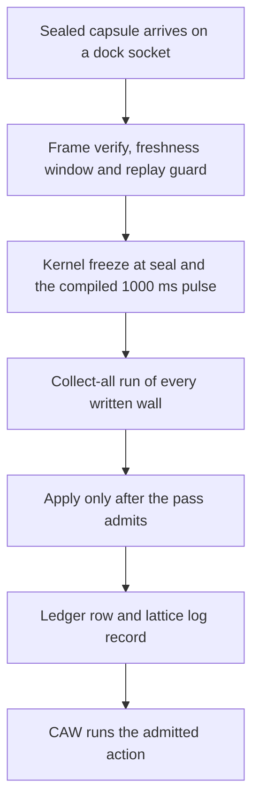

# 01 / AEP Base Node

Status: normative. Stability: evolving. The docks, the kernel pass and the runtime ledger are the code every other component relies on.

## What it is

The AEP Base Node is the governance kernel of the protocol. It runs on your own machine as one daemon and every other component docks into it. An agent proposes an action in a sealed capsule and the Base Node opens the capsule, judges it and applies the action only after every check passed. The folder lives at the repository root and not under `AEP-Components/`, because the kernel is mandatory and no component of choice.

## Place among the 18

Work arrives as sealed capsules on the Lattice Channels (08), either straight from a component or through UCB (02). The Base Node hosts UCB (02) under `AEP-Docks/` and it runs the Base Node Pulse (10) as its clock. It places each proposal in the One Validation Envelope (03) and the Admit Gate (04) judges it with the GAP policy (06), the Scanners (12) and the identity from AgentMesh (13). After an allow the CAWs (11) run host commands and Lattice Memory (15) stores the shape of the judged proposal.

## What ships in 2.9

- The daemon `aep-base-node` with four Unix socket docks named inference, validation, regulation and future. A dock accepts sealed capsules only.
- One kernel pass per capsule: verify the seal, freeze the clock, wait one pulse of 1000 ms, judge every wall together, write the ledger row and then apply.
- The runtime ledger, a SQLite lattice log with the command line program `aep-lattice-log`.
- The Data Dock, an HTTP surface on port 8413 for records the kernel already admitted.
- The outbound web request for agents on one granted action path with an operator route list.
- The component registry with catalog and manifests.
- The Agent Control Hub crate for agent permissions.
- The Potomitan crate with a mesh packet plane, a peer registry and routing, proven by its crate tests and by the conformance check for mesh mode. The shipped daemon reads the mesh peer file and reports the mesh mode (internet, potomitan or offline) in its health answer. It binds no mesh socket. Mesh traffic from the daemon is planned.
- The multi base node crate, an optional experimental surface outside the default build.

## Layout

| Path | Role |
|------|------|
| `AEP-Crate/` | The crate `aep-base-node` with the daemon and the `aep-lattice-log` program |
| `AEP-Docks/` | Dock specs, UCB (02) and the Universal Connect Dock |
| `AEP-Registry/` | Component catalog, manifests and schemas |
| `AEP-Agent-Control-Hub/` | Kernel extension for GAP sessions, mounts and agent permissions |
| `AEP-Potomitan/` | Mesh fallback crate `aep-potomitan` |
| `AEP-Multi-Base-Node/` | Optional experimental crate for several kernels |
| `AEP-Components/kernel-types/` | The one public set of kernel types |
| `AEP-Components/live-entry/` | The live entry: load, Admit and Apply in one process |
| `AEP-Components/one-live-evaluation/` | Source check: one Admit function judges the opened capsule |
| `AEP-Components/wall-set-backpressure/` | The deny report with closed walls, class and repair |

## Interfaces

- Binaries: `aep-lattice-log` and `aep-base-node` with `--daemon`, `--health` and `--self-test`.
- Sockets: `inference`, `validation`, `regulation` and `future` under `$AEP_DATA/sockets`.
- Ports: 8413 for the Data Dock. UCB (02) listens on 8412 as a service of its own.
- Environment: `AEP_DATA`, `AEP_GATEWAY_ROUTES`, `DATA_DOCK`, `DATA_DOCK_API_KEY`, `AEP_LOG`, `AEP_LOG_JSON` and `AEP_LOG_FILE`.
- Files: `lattice.yaml`, `gateway-routes.json` and the `action-lattice.db` store in the data folder.

## Four tiers of the page and four planes of the code

The AEP page draws the Base Node in four tiers. The code describes itself in four planes. Both describe the same kernel and this table maps them.

| Tier on the page | Planes and parts in this tree |
|------------------|-------------------------------|
| Kernel zone for governance | The intake and dock plane and the kernel pulse pass: `AEP-Crate/src/docking/` and the Base Node Pulse (10) |
| Wall set for redundancy | The wall set: the wall crates of the One Validation Envelope (03) and the Admit Gate (04) |
| Architectural efficiency and dispatch | The record plane with Apply: the runtime ledger, the registry and the Agent Control Hub |
| Potomitan mesh fallback | `AEP-Potomitan/`, the mesh crate described under What ships in 2.9 |

## Architecture shape

The Base Node is a pyramid with its tip cut off. Each plane carries the one above it, so the planes widen downward. The tip is cut off because the kernel pass does not sit above the tree as an authority. It is the floor that every component docks into.

```text
            /                                            \
           /           intake and dock plane            \
           +--------------------------------------------+
         /                                                  \
        /                kernel pulse pass                 \
        +--------------------------------------------------+
      /                                                        \
     /                        wall set                        \
     +--------------------------------------------------------+
   /                                                              \
  /                         record plane                         \
  +--------------------------------------------------------------+
```

The four planes, top to bottom:

| Plane | What it carries |
|-------|-----------------|
| Intake and dock plane | Docking listeners on the inference, validation, regulation and future sockets, sealed frame verify, the freshness window, the replay guard and side channel events |
| Kernel pulse pass | Freeze at seal, the compiled 1000 ms pulse and one collect-all run of every written wall |
| Wall set | Agent permission, lattice membership, writing walls, temporal bounds, envelope walls and wall set back pressure |
| Record plane | The runtime ledger, which is the SQLite lattice log, plus derived ledger rows and the component registry |

The path a frame takes through those planes:



The executor after admit is CAW at AEP-CAW/.

## What lives here

Base Node **is** the local agent control kernel. Governance code, registry, mesh and the Hub crate live under `AEP-Base-Node/`:

| Module | Path | Role |
|--------|------|------|
| Docking servers | `AEP-Crate/src/docking/` | The facade `mod.rs` with the children serve, apply, pulse, freshness and rate for the inference, validation, regulation and future Unix sockets |
| Runtime parts | `AEP-Crate/src/dock_parts.rs` | DockingRuntime as five owned parts named io, keys, defence, admit and record |
| Dock keys | `AEP-Crate/src/dock_keys.rs` | Facade over `dock_keys_store.rs` for load, permissions and the refusal of a silent regen and `dock_keys_provision.rs` for the operator mint and the first mint of the data-dock key. Secret files are mode 0600 |
| Official log | `AEP-Crate/src/dock_log.rs` | The one aep-base-node log with a closed set of event ids and redaction of keys, seal material and grants |
| Task manifests | `AEP-Crate/src/task_manifest.rs` | UCB agent contracts (`AEP_TASK_MANIFEST_DIR`) |
| CORRECTWRITING_EN kernel | `AEP-Crate/src/correctwriting_en.rs` | writing.gap enforcement (`no_em_dashes`, `no_en_dashes`, `no_dash_substitutes`, `no_minus_as_dash`, `no_double_hyphen`, `no_oxford_comma`) |
| Side-channel monitor | `AEP-Crate/src/side_channel_monitor.rs` | Anomaly events on validation dock |
| Runtime ledger | `AEP-Crate/src/lattice_log.rs` | The one named runtime ledger. dynAEP event export over the `action-lattice.db` store plus the `aep-lattice-log` CLI. Every other ledger surface is a derived view or a capability |
| Data Dock HTTP | `AEP-Crate/src/data_dock.rs` | JSON on 8413 over already-admitted lattice records where frontend writes are sealed on the server and then enter the four existing docks. See [`DATA-DOCK.md`](../AEP-User-Experience/docs/DATA-DOCK.md) |
| Agent Control Hub | `AEP-Agent-Control-Hub/crate` | Kernel extension. The daemon loads the crate and binds GAP session, mount and agent-permission state. |

Register new components in **`AEP-Base-Node/AEP-Registry/catalog.json`** + **`AEP-Base-Node/AEP-Registry/components/*.json`**. See [`AEP-Registry/README.md`](AEP-Registry/README.md) for manifest schema and error categories.

## Component layout

| Path | Contents |
|------|----------|
| `AEP-Crate/` | `aep-base-node` Rust crate + `aep-lattice-log` CLI binary. Nested rust leaf crate/ under a product remains. |
| `AEP-Docks/` | Live dock products ucb and universal-connect. Spec table names kernel admit dock. |
| `AEP-Potomitan/` | POTOMITAN mesh peer registry (`aep-potomitan` crate) |
| `AEP-Multi-Base-Node/` | Multi base node mode: federate multiple Base Node kernels (optional experimental surface, not in the default build) |
| `AEP-Registry/` | Component catalog + manifests (`catalog.json`, `components/*.json`) |
| `AEP-Agent-Control-Hub/` | Kernel extension. The daemon loads the crate and binds GAP session, mount and agent-permission state. |

## Docking ports

| Port | Path suffix | Priority |
|------|-------------|----------|
| Inference Engine | `/inference` | High |
| kernel admit | `/validation` | High |
| Future Features (reserved internal) | `/future` | High |
| Regulation Module (LRPs) | `/regulation` | Medium |

All traffic uses Lattice Channels with PQEncryptedCapsule encryption.

Each port holds its own share of 16 of the 64 connection slots, so connections that fill one port leave the other ports free. A connection that completes no line in 30 seconds is closed. A connection that draws 32 refused lines is closed too. A refused line writes at most one anomaly row, which bounds the rows one connection can write. The signature of the registered key is checked before a frame spends a rate slot, so a frame that names an agent and fails the signature spends neither the dock wide slot nor a slot of that agent. Admit, Apply and every beat run on the blocking pool of the daemon and never on the workers that read the sockets.

## Kernel pulse

Two compiled clocks live in `aep-base-node-pulse`. Pulse hold is the wait after a sealed capsule (the encrypted frame on the wire) is opened: Base Node freezes the clock at seal, waits 1000 ms, then runs every check together and only then carries out the allowed action. Putting a capsule on the dock is not that check because after the wait the client asks for the result by the capsule hash so a deny names the closed walls and an allow returns an event id. Allowed clock drift is 50 ms against the freeze which is why a 1000 ms hold still meets drift while a capsule held longer than 5000 ms is aged out.

The freeze is the Base Node clock, read when the frame arrives. The timestamp an agent seals into its event is a claim. Base Node compares it with its own clock and never adopts it. A stamp more than 50 ms ahead is refused at enqueue as `temporal:future_skew`. The stamp is written before the seal and read after the transit, so behind the clock it may be as old as the age bound of 5000 ms. An older stamp is refused as `temporal:stale_event`. A refused frame takes no room in the pulse queue. A stamp in the past does not shorten the hold: the capsule turns ready one pulse after it arrived. One signer holds at most half of the queue (128 capsules and 131072 bytes), so the frames of one agent never shut out every other agent.

Every wall judges the signer of the frame. An event may leave `agent_id` out or repeat the signer. An event that names another agent closes `frame.agent_binding`. The permission of the Agent Control Hub is one of the Admit walls (`hub.agent_permission`). After Admit the ledger row is written first, then the live entry is changed, then an LRP contract is registered and, on the gateway path only, the outbound request starts. A deny or a ledger error leaves the live entry unchanged and sends nothing.

Wire sent_at freshness is the other clock. Before open, `frame_is_fresh` checks `sent_at_unix` against `MAX_FRAME_AGE_SECS` (300) and `MAX_FRAME_FUTURE_SKEW_SECS` (60). The wire window is wider because it covers transit before open while pulse age covers hold after freeze so five seconds of pulse age is not the 300 second wire window.

The wait is the compiled constant `PULSE_MS` in `AEP-Components/base-node-pulse/crate`. Wire constants `MAX_FRAME_AGE_SECS` and `MAX_FRAME_FUTURE_SKEW_SECS` are compiled beside it. There is no environment variable and no `pulse_ms` key in `dynaep-config.yaml`. TypeScript dynAEP remains a standalone component and does not own this wait. The 1000 ms figures in dynAEP timekeeping are NTP slew bounds and LARGE_STEP clock-sync caps rather than the kernel wait so LARGE_STEP must not be treated as this wait.

### How the wait can be changed in theory

A builder who wants a different wait edits the compiled `PULSE_MS` constant and rebuilds Base Node. Freeze-at-seal must stay so the hold is judged against the freeze rather than a moving clock. Allowed drift must not be set to the wait length: crate tests require `MAX_DRIFT_MS != PULSE_MS` and reject a 1000 ms drift default so `MAX_DRIFT_MS` must not be set to 1000. Age must stay longer than the wait because if `PULSE_MS` were greater than `MAX_AGE_MS` (5000) capsules would expire before they became ready so pulse age 5000 must not be replaced with 300 seconds. Current crate tests also pin `PULSE_MS == 1000` so a theoretical rebuild must update those pins. This is a kernel rebuild rather than a yaml or env toggle.

## Kernel outbound request

Agent tools do not call the internet directly. They ask Base Node to make the call for them through the inference dock (the JavaScript helper `latticeGatedFetch` does this). Base Node checks the request with Admit, writes it to the ledger, fetches the page and hands the answer back. This covers only the web requests that Base Node makes for agents. The own network access of an agent is governed by the AEP-CAW network rules and is not changed by anything below.

Base Node fetches a web address only when all of these hold:

1. The request says it is an outbound web request: its action path is `gateway:outbound_http`. A `url` field in any other message is plain data and Base Node never fetches it.
2. The agent may make outbound web requests, in the lattice and in the Agent Control Hub.
3. The address is on the approved list of the operator.
4. The address is a public internet address and no internal one.
5. The agent has fewer than 2 requests running and Base Node has fewer than 16.

When any of these fails, the request is refused, nothing is fetched and the answer names the reason.

### Set it up

1. Write the approved list. Create `gateway-routes.json` in the Base Node data folder (`$AEP_DATA`, `/data/aep` in the container). One entry per site:

   ```json
   {"routes": [
     {"id": "weather", "scheme": "https", "host": "api.weather.example", "path_prefix": "/v1", "methods": ["GET"]},
     {"id": "github", "scheme": "https", "host": "api.github.com", "methods": ["GET", "POST"]}
   ]}
   ```

   `id` is a name of your choice. `scheme` is `https` or `http`. `host` is the exact host name, so `api.github.com` does not open `github.com`. `port` is optional and defaults to 443 for https and 80 for http. `path_prefix` is optional and defaults to `/`, which opens every path; `/v1` opens `/v1` and everything below it, not `/v10`. `methods` lists the allowed methods. To keep the file somewhere else, set `AEP_GATEWAY_ROUTES` to its path.

2. Allow the agent in the lattice. In `lattice.yaml` of the data folder, give the action `gateway:outbound_http` and name the agents that may use it:

   ```yaml
   actions:
     gateway:outbound_http:
       category: agent_action
       parents: []
       children: []
       agent_permission: ["agent-a"]
   ```

3. Allow the agent in the Agent Control Hub. In a policy file under `gap/policies/reference/` of the data folder, add a permission row:

   ```yaml
   metadata:
     agent_permission:
       - agent_id: agent-a
         action: gateway:outbound_http
   ```

4. Restart Base Node, because it reads the list once at start. In the Docker deploy, run this in the repository folder:

   ```bash
   docker compose restart aep && docker compose logs --tail 50 aep | grep -i "gateway route list"
   ```

   The first command restarts the Base Node container `aep-base-node`. The second shows its log lines about the route list. No output means the list was read. A line with `gateway route list refused` names the mistake in the file. Every outbound request is refused until you fix the file and restart again.

### Check it

Send one request from the agent for a listed address. The answer carries `http` with the status of the site. A request to an address that is not on the list is refused with the reason `gateway.route`. A request from an agent without the permission is refused with `gap.agent_permission` or `hub.agent_permission`.

### What is always refused

- Internal addresses: loopback (127.0.0.1, localhost), private networks (10.x, 172.16 to 172.31, 192.168.x), 100.64.x, cloud metadata (169.254.x, `metadata.google.internal`) and the reserved ranges. For a test setup, `AEP_LATTICE_ALLOW_LOOPBACK=1` opens loopback and `AEP_LATTICE_ALLOW_PRIVATE=1` opens private, 100.64.x and link local addresses. Reserved ranges never open.
- Redirects. Base Node does not follow them.
- Slow or large replies: the connection gets 3 seconds, the whole request 8 seconds and the reply at most 8 MiB.

### How the request runs

The request runs on a thread of its own after the ledger row is written, so a slow site never holds up other agents. The agent first reads pending with `http_queued` and then the result. The address check is the shared range list of `AEP-Components/egress-address`, which the UCB egress proxy and the JavaScript helpers also use. Base Node looks the host up once, every address must pass and it connects only to those addresses.

## Operator

`aep-base-node --health` prints the BaseNodeHealth JSON without binding any dock. The exit code is 0 for ok, 1 for degraded and 2 for error, so a script can gate on it. The flag cannot be combined with `--daemon` or `--self-test`.

The status comes from one rollup that the daemon ready log and the Data Dock `GET /health` share. It is `error` when the lattice ledger is closed and `degraded` when the dock sockets are missing, the Agent Control Hub is not loaded or the mesh peer file failed to load. Any other state is `ok`. The report also carries `sqlite_closed`, `last_tls_handshake_err` and `drain_aborted_tasks`.

The daemon listens on four unix docks for inference, validation, regulation and future. UCB remains on 8412 and Data Dock serves HTTP JSON on 8413 as a surface in front of those docks rather than a fifth dock. Data Dock binds loopback by default. On any other host it uses `DATA_DOCK_API_KEY` when set, else the key file `$AEP_DATA/keys/data-dock.http-key`, else it mints that file with mode 0600 on first boot as described in the Data Dock guide. `DATA_DOCK=0` turns the HTTP surface off. See [`DATA-DOCK.md`](../AEP-User-Experience/docs/DATA-DOCK.md) for the routes.

The daemon logs ready only when the status is ok. A bind failure or an error status after bind drains the docks and exits 2. SIGTERM or SIGINT drains, which joins tasks for up to 2 seconds and aborts the rest, removes the sockets, closes SQLite and exits 0. A refused TLS handshake is logged and stored for health but never stops the daemon.

The official log reads its filter from `AEP_LOG`, then `RUST_LOG` and falls back to `info`. It always writes to stderr. `AEP_LOG_JSON=1` switches to JSON lines and `AEP_LOG_FILE=1` also appends to `$AEP_DATA/log/aep-base-node.log` with mode 0600 in a 0700 folder, refusing a world-writable parent the same way as the lattice database.

## Build

```bash
cargo build --release -p aep-base-node
# binaries: rust/target/release/aep-base-node, aep-lattice-log
```

The default build is the single Base Node kernel. Other workspace crates, such as the multi base node, are built on purpose and they are not part of the default build or the default deployment.

Verify the kernel with `cargo test -p aep-base-node --lib`. The same command runs in `.github/workflows/base-node.yml` on every push and pull request.

## Limits

- The Base Node does not write policy. Policies are GAP (06) files loaded at start.
- It does not confine a process on the host. The CAWs (11) do.
- It does not attach external systems by itself. UCB (02) does.
- The pulse length is no setting. The Base Node Pulse (10) compiles it.

## Run and test

```bash
cargo build --release -p aep-base-node
./rust/target/release/aep-base-node --self-test
cargo test -p aep-base-node --lib
cargo test -p aep-potomitan -p aep-agent-control-hub
```

## Related documents

- `AEP-Base-Node/AEP-Registry/README.md` for the catalog and the manifest schema
- `AEP-Base-Node/AEP-Docks/README.md` for the docks
- `AEP-Base-Node/AEP-Potomitan/README.md` for the mesh crate
- `AEP-User-Experience/docs/DATA-DOCK.md` for the Data Dock routes
- `AEP-User-Experience/docs/AEP-2.9-SECURE-DEPLOYMENT-GUIDE.md` for deployment
- `THREAT_MODEL.md` for the threat model of each layer
