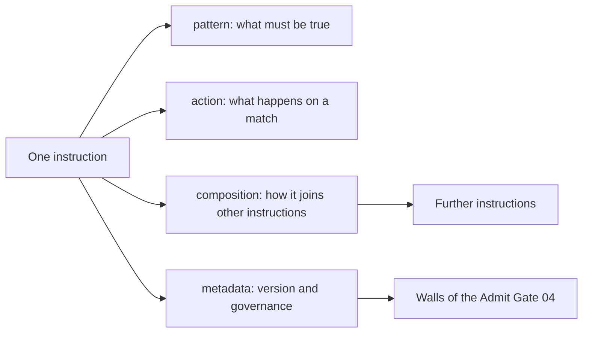
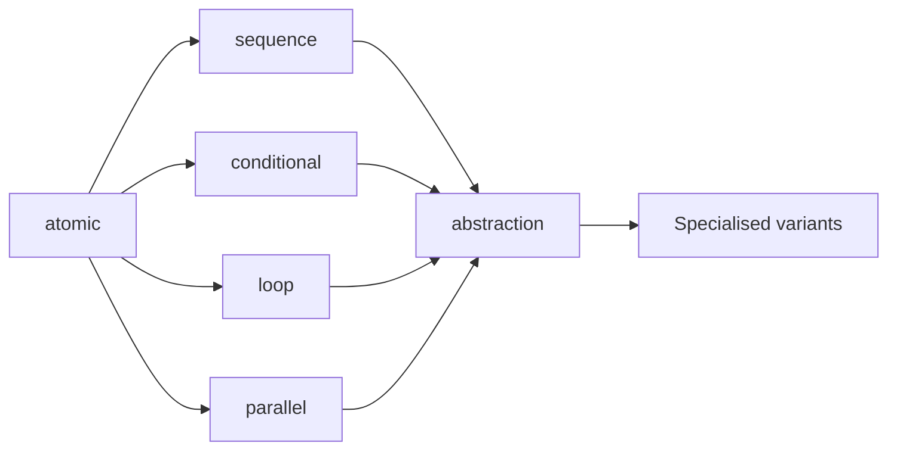
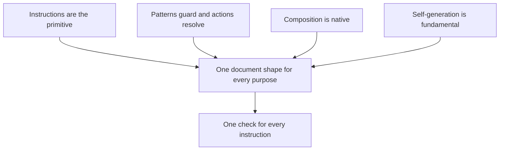
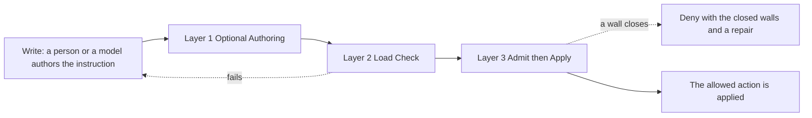
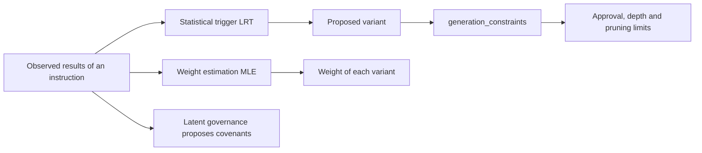
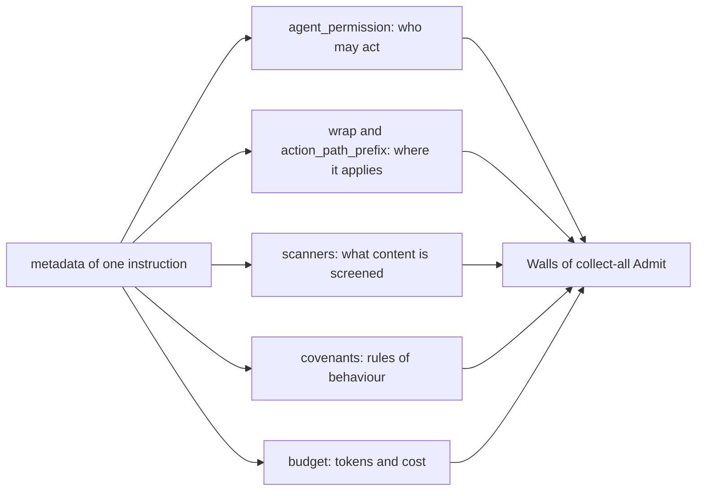
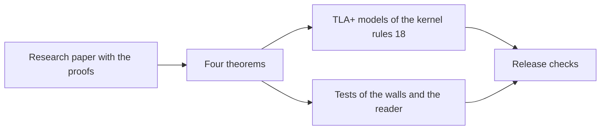
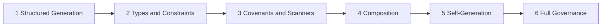
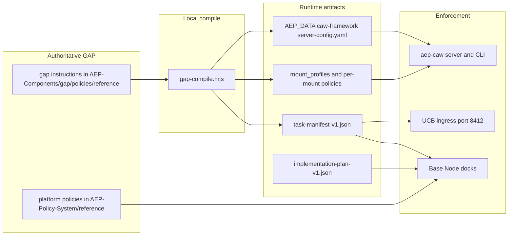

# 06 / GAP

Status: normative. Stability: stable.

## What it is

GAP (Governed Agentic Programming) is the native instruction language of AEP. An instruction is the smallest unit: a policy, an agent profile, a sandbox profile, a task manifest and a workflow are all instructions. Instructions combine through six composition types: atomic, sequence, conditional, loop, parallel and abstraction. GAP is the only form of policy the Admit Gate loads.

## Place among the 18

An operator writes GAP files. The Admit Gate (04) receives them as walls, the CAWs (11) receive sandbox profiles compiled from them and UCB (02) receives task manifests. The AEP Base Node (01) loads the policy files at start. dynAEP (07) binds policy nodes into the hyperlattice.

## What ships in 2.9

- The GAP meta-schema in version 1.3 as the live authoring constraint, pinned to its upstream commit and checked byte for byte.
- Reference instructions for coding governance, CAW sandbox profiles, task manifests and implementation plans.
- `lib/gap-compile.mjs`, the compiler from GAP profiles to CAW mount profiles and policies.
- The live policy files, presets, the Policy Builder and the Schema Builder in `AEP-Policy-System/`.
- Transpilers to OPA Rego and Cedar and a YAML policy importer in `AEP-Components/policy-engine/`.
- The schema has the fields for self-generation, for example `self_generate` and `lrt`. The Schema Builder estimates fields with MLE and the Policy Builder detects invariants in data. A runtime with self-generation of new policies through LRT and MLE, as the page describes it, is planned.

## Layout

| Path | Role |
|------|------|
| `schemas/` | The GAP meta-schema files |
| `policies/reference/` | Reference instructions |
| `lib/gap-compile.mjs` | The profile compiler |
| `bin/check-gap-pin.mjs` | The check of the pinned upstream bytes |
| `gap-pin.txt`, `gap-versions.toml` | The upstream pin |
| `FILE-FORMAT.md` | Notes on the file format |
| `tests/` | vitest suites for the compiler and the pin check |
| `AEP-Components/gap-schema-profile-v13/` | The live Admit profile of schema version 1.3 as a crate |
| `AEP-Components/policy-engine/` | Policy loading, evaluation and transpilers |
| `AEP-Components/policy-leftover-skins/` | Source check: only GAP reference documents load as live walls |
| `AEP-Policy-System/` | Live policy files, presets and builders |

## Interfaces

- Command: `node AEP-Components/gap/lib/gap-compile.mjs` with `--list-profiles` and `--materialize <data folder>`.
- File format: one `.gap` file per instruction, with an optional second YAML document for a runtime profile. See `FILE-FORMAT.md`.
- Compile targets: CAW settings under `$AEP_DATA/caw-framework/`, `task-manifest-v1.json` and `implementation-plan-v1.json`.
- Agent permission is the field `agent_permission`. The presence of a `trust_ring` field is a deny.

## The language in this file

The sections below describe the GAP language in the order of the GAP page: the anatomy of an instruction and then the seven sections Six Native Primitives, Everything as Instruction, Write. Check. Admit., Instructions Generate Instructions, Structural Governance, Mathematically Verified and Six-Rung Ladder. Each of the seven says what it is, what the AEP tree ships, where it lives in the AEP tree and how to run or test it here. The GAP repository at [https://github.com/thePM001/GAP](https://github.com/thePM001/GAP) is the home of the language, of its compiler `gapc` and of the same seven sections worded for that repository. The content that only AEP has follows after the seven sections.

## Anatomy of an instruction

An instruction is one document in a `.gap` file. Its pattern states what must be true, its action states what happens when the pattern matches and its composition states how it joins other instructions. The governance of an instruction travels inside the same document, so a runtime that loads the instruction also loads the limits it must keep.



An instruction has eleven top level fields and six of them are required. The live meta-schema is closed, so a field outside this table fails the check.

| Field | Required | What it contains |
| --- | --- | --- |
| `address` | yes | The `domain` and the `id` that name the instruction |
| `pattern` | yes | A text or an object with a guard, input, output, events, constraints and invariants |
| `action` | yes | What happens on a match, in one of five action types |
| `weight` | yes | A number from 0 to 1 that ranks the instruction among its alternatives |
| `composition` | yes | One of six composition types |
| `metadata` | yes | Provenance, version, stability and the governance fields |
| `types` | no | Type definitions that the pattern and the action refer to |
| `execution` | no | Retry, timeout and the behaviour on exhaustion |
| `weight_estimation` | no | Settings for the estimate of the weight from observed results |
| `enabled` | no | A flag that is read at load time. An instruction with the value false is still loaded and still judged |
| `extensions` | no | Data of a host that GAP does not read, one object per host. AEP keeps its own policy keys under `extensions.aep` |

The smallest legal instruction carries the six required fields:

```yaml
address:
  domain: com.example.finance
  id: pay.v1
pattern:
  guard: "true"
action:
  type: template
  content: pay
weight: 1.0
composition:
  type: atomic
metadata:
  provenance: "system.seed"
  version: "1.0.0"
  stability: experimental
  wrap: finance
  agent_permission:
    - finance.pay
```

A file uses the extension `.gap`, the encoding UTF-8 and YAML 1.2 or JSON as its syntax, with one instruction per document. `AEP-Components/gap/FILE-FORMAT.md` contains the notes on the file format for the policies of this tree. A kernel loads policies as JSON-encoded GAP. The form below is legal GAP, because the kernel reads the instruction object and not its skin:

```json
{
  "address": {"domain": "aep.reference.writing", "id": "conventions.v1"},
  "pattern": {"guard": "true"},
  "action": {"type": "template", "content": "Apply AEP 2.9 writing conventions."},
  "weight": 1.0,
  "composition": {"type": "atomic"},
  "metadata": {"provenance": "AEP 2.9", "version": "1.0.0", "stability": "stable"}
}
```

## Six Native Primitives

**What it is:** Composition is part of the language and not a library on top of it. Every instruction names one of six composition types, so a workflow is itself an instruction built from instructions.



| Composition type | Meaning | Fields it requires |
| --- | --- | --- |
| `atomic` | One instruction that stands alone | none |
| `sequence` | Instructions that run one after the other | `steps` |
| `conditional` | A choice between two instructions | `condition` and `then`, with an optional `else` |
| `loop` | An instruction that repeats until a condition holds | `body`, `until` and `max_iterations` |
| `parallel` | Instructions that run side by side and merge by all, any or majority | `branches` and `merge` |
| `abstraction` | A parameterised instruction with variants | none, with optional `parameters` and `variants` |

A sequence of three instructions is written like this:

```yaml
address:
  domain: com.example.support
  id: answer-ticket.v1
pattern: |
  Answer a support ticket in three governed steps.
action:
  type: template
  content: Classify the ticket, draft the answer and send it.
weight: 0.8
composition:
  type: sequence
  steps:
    - address:
        domain: com.example.support
        id: classify.v1
    - address:
        domain: com.example.support
        id: draft.v1
    - address:
        domain: com.example.support
        id: send.v1
metadata:
  provenance: "system.seed"
  version: "1.0.0"
  stability: experimental
```

The steps of a `pipeline` action are written with three operators: `→` pipes the output of one step into the next, `|` runs steps in parallel and `>>` is a gate that pauses for approval.

**What ships:** The meta-schema with the six types as a byte copy of the GAP repository, pinned to its commit. The compiler `gapc`, which enforces the fields that each type requires, lives in the GAP repository. The Graph Engine (05) is the component of this tree that runs a graph of steps.

**Where it lives:** The block `Composition` of `AEP-Components/gap/schemas/gap-meta-schema-v1.3.json`.

**Run and test:** `node AEP-Components/gap/bin/check-gap-pin.mjs` proves that the schema bytes equal the pinned commit of the GAP repository.

## Everything as Instruction

**What it is:** GAP has one building block. An agent, a workflow, a validator and a governance rule are all written as instructions. Four principles follow from that.



| Principle of the page | What it means in a file |
| --- | --- |
| Instructions Are the Primitive | There is no second kind of document. A policy, a sandbox profile and a task manifest share one schema |
| Patterns Guard, Actions Resolve | The pattern decides whether the instruction applies and the action decides what is produced |
| Composition Is Native | The section Six Native Primitives of this file |
| Self-Generation Is Fundamental | The section Instructions Generate Instructions of this file |

An action has one of five types:

| Action type | What it produces | Fields it requires |
| --- | --- | --- |
| `template` | Text from a template | `content` |
| `structured` | Output that follows a declared type | `schema` |
| `code` | Code in rego, javascript, python or typescript | `language` and `content` |
| `reference` | The result of another instruction | the address of that instruction |
| `pipeline` | The result of several steps | the list of steps |

A pattern is either a text or an object. The object form may carry a `guard`, typed `input` and `output`, an event subscription, `constraints`, `validators` and `invariants`. This instruction reviews pull requests and returns a typed result:

```yaml
address:
  domain: com.myorg.dev
  id: code-reviewer.v1
pattern: |
  Review pull requests for correctness, style and security.
action:
  type: structured
  schema: CodeReview
  structured_generation: true
  content: |
    You review pull requests for correctness, style and security.
    Every comment must reference a specific file and line number.
weight: 0.90
composition:
  type: atomic
metadata:
  provenance: "system.seed"
  version: "1.0.0"
  stability: stable
  grade: 8
  agent_permission:
    - review.pull_request
execution:
  retry:
    max_attempts: 3
    backoff: exponential
  timeout_ms: 30000
  on_exhaustion: fail
types:
  CodeReview:
    format: json
    fields:
      summary: string
      issues_found: boolean
      verdict:
        type: enum
        values: [approve, request_changes, comment_only]
```

The retry of an instruction at run time is written on the instruction itself, in the block `execution`.

**What ships:** Sixteen reference instructions for sandbox profiles, coding governance, task manifests, implementation plans and the federation of Base Nodes, together with the platform policies of a deployment. Every policy the Admit Gate (04) loads is a GAP instruction.

**Where it lives:** `AEP-Components/gap/policies/reference/` for the reference instructions and `AEP-Policy-System/reference/` for the platform policies.

**Run and test:** `node AEP-Components/gap/lib/gap-compile.mjs --list-profiles` lists the profiles that the reference instructions define.

## Write. Check. Admit.

**What it is:** GAP is enforced in three layers and no layer requires that a language model has seen GAP during training. Any model can author GAP instructions, because the check and the decision happen outside the model.



| Layer | Name on the page | What happens | Where it runs in AEP |
| --- | --- | --- | --- |
| 1 | Optional Authoring | A decoder may constrain the tokens of a model to the declared type. Constrained decoding is not Admit | Nowhere yet. The engine file of this folder is a placeholder that refuses every call |
| 2 | Load Check | The instruction is validated before it becomes active | In the policy loader and in the source check that lets only GAP reference documents load as live walls |
| 3 | Admit then Apply | Every wall is judged together for one action. Only an action without a closed wall is applied | In the Admit Gate (04), on the One Validation Envelope (03), after the Base Node Pulse (10) |

Authoring a `.gap` file is itself an instruction write, so the file reaches a runtime through the same Layer 3 as every other action. In live evaluation the proposal is sealed in a capsule, the clock is frozen at seal and the node waits 1000 ms before it runs every check together as collect-all Admit. If two walls fail both are listed. A close names the closed walls, their reasons and a prescribed repair. A retry must seal a new capsule, because the same sealed bytes are a replay.

The detail of that path lives with the components that own it: the walls and the derived ledger of fifteen rows in `AEP-Components/envelope/README.md`, the kernel pulse in `AEP-Components/base-node-pulse/README.md` and the trust bundle in `AEP-Components/lattice-channels/README.md`. The GAP repository describes the same path from the side of the language in its document [LIVE-EVALUATION.md](https://github.com/thePM001/GAP/blob/main/docs/LIVE-EVALUATION.md) and compares Layer 1 with tools for constrained decoding in [GAP-AND-CONSTRAINED-DECODING.md](https://github.com/thePM001/GAP/blob/main/docs/GAP-AND-CONSTRAINED-DECODING.md).

**What ships:** Layer 2 and Layer 3 in full. This tree is the runtime of GAP, so the clock freeze, the wait, the collect-all Admit and Apply are real code here. A decoder for Layer 1 is planned and the tree does not carry one.

**Where it lives:** `AEP-Components/admit/` for the Admit Gate, `AEP-Components/gap-schema-profile-v13/` for the walls that read an instruction, `AEP-Components/policy-leftover-skins/` for the source check and `AEP-Components/gap/lib/gap-constrained-engine.mjs` for the unwired Layer 1 placeholder.

**Run and test:** `cargo test -p aep-admit -p gap-schema-profile-v13 -p aep-policy-leftover-skins` from the repository root.

## Instructions Generate Instructions

**What it is:** An instruction of the type abstraction may ask for specialised variants of itself. The language describes when a new variant is proposed, how its weight is estimated and which limits the process must keep.



| Subject on the page | Fields of the language |
| --- | --- |
| Statistical Trigger (LRT) | `generation_constraints.lrt` with its switch, the significance level and the smallest sample per class |
| Weight Estimation (MLE) | The top level block for weight estimation with its switch, the smallest sample, the decay window and the floor |
| Latent Governance | `metadata.latent_governance` with its switch, the rejection threshold, the smallest number of observations and `auto_apply` |
| Limits of the process | `max_variants`, `min_quality_threshold`, `require_approval`, `max_generation_depth`, `pruning` and `promotion_threshold` |

```yaml
address:
  domain: com.example.support
  id: answer.v1
pattern: |
  Answer a customer question in the tone of the brand.
action:
  type: template
  content: Answer the question in two short paragraphs.
weight: 0.7
composition:
  type: abstraction
  parameters:
    - language
  self_generate: true
  generation_constraints:
    max_variants: 10
    min_quality_threshold: 0.92
    require_approval: true
    lrt:
      enabled: true
      significance: 0.01
weight_estimation:
  enabled: true
  min_samples: 50
metadata:
  provenance: "system.seed"
  version: "1.0.0"
  stability: experimental
```

**What ships:** The fields above in the meta-schema. The Schema Builder estimates fields from data with MLE and the Policy Builder detects invariants in data, so both builders propose rules that a person reviews. A runtime that observes results, runs the test and generates variants by itself is planned and the tree does not carry one.

**Where it lives:** `AEP-Policy-System/schema-builder/` and `AEP-Policy-System/policy-builder/` for the builders and the block `GenerationConstraints` of the meta-schema for the fields.

**Run and test:** The README of each builder names its commands. The meta-schema rejects a value outside its range, such as a significance level above 0.1.

## Structural Governance

**What it is:** The governance of an instruction is written in its own `metadata`. A runtime does not look up a second policy file, because the limits arrive with the instruction.



| Field of metadata | What it governs |
| --- | --- |
| `agent_permission` | Who may act. Each grant says that one agent may do one action. A grant is not a rank |
| `wrap` | The lattice wrap that the instruction binds to |
| `action_path_prefix` | The prefix of the action path that the instruction binds to |
| `scanners` | The content scanners to run, from the eleven names below |
| `covenants` | Rules of behaviour, each ending in `[hard]` or `[soft]` |
| `budget` | Limits for tokens and cost, with an optional daily cap |
| `proof` | Whether the result is signed and written to a ledger, with ed25519 or ml-dsa-65 as optional algorithms |
| `fleet` | The largest number of instances and the hourly cost cap |
| `knowledge` | The scope of the knowledge base and the switch against context rot |
| `tools` | The lists of allowed and forbidden tools |
| `aspect` | The classification label of the instruction |

The eleven scanner names of the schema are `pii`, `injection`, `secrets`, `jailbreak`, `toxicity`, `url`, `data_profiler`, `prediction`, `brand`, `regulatory` and `temporal`. A structured constraint or invariant carries one of three severities: `hard` blocks activation, `soft` is logged and `advisory` is information only.

```yaml
metadata:
  agent_permission:
    - review.pull_request
  wrap: governance
  scanners:
    - pii
    - secrets
    - injection
  covenants:
    - "every comment must reference a file and line number [hard]"
    - "verdict must be one of: approve, request_changes, comment_only [hard]"
  proof:
    sign: true
    algorithm: ed25519
    ledger: true
  budget:
    max_tokens: 30000
    max_cost: 0.50
```

Three rules decide the agent permission wall. A declared grant opens the wall for the named agent and action. A declared empty list closes every agent action. A document without the field leaves agent permission to other walls. The presence of `trust_ring`, of a rank or of a trust score on a live document is Deny and closes the wall `gap:leftover_rank_field`, so do not set these fields.

Writing and security are always-on stems and they evaluate on every action path. Every other instruction binds through its wrap or its prefix. A proof algorithm that an instruction names is optional: the trust bundle mode of live AEP 2.9 is sha256-structure and a signed proof is not the default attach.

**What ships:** All of it as running code. The agent permission wall, the leftover rank wall, the wrap bind wall and the guard wall are in the profile crate. The Scanners (12) run a pipeline whose scanner set is wider than the eleven names of the schema. Covenants and permissions are judged in the Admit Gate (04) and Economics (14) counts the budget.

**Where it lives:** `AEP-Components/gap-schema-profile-v13/` for the walls, `AEP-Components/scanners/` for the scanners, `AEP-Components/covenant/` for the covenants and `AEP-Components/economics/` for the budget.

**Run and test:** `cargo test -p gap-schema-profile-v13` and `npx vitest run AEP-Components/scanners` from the repository root.

## Mathematically Verified

**What it is:** The claims of GAP are stated as theorems and not as promises. The page names four of them: Admit then Apply, Self-Governance Fixed Point, Composition Preservation and Type Soundness.



**What ships:** The proofs are published in the research paper at [https://github.com/thePM001/GAP-research-paper-002](https://github.com/thePM001/GAP-research-paper-002) and not in this tree. The tree carries the executable side: five TLA+ models of the kernel rules, among them the conjunction of Admit and the order of seal, freeze, wait, collect and Apply, together with the tests of the walls. A stored result of an exhaustive model check is planned, as the README of component 18 states.

**Where it lives:** `AEP-Components/tla/` for the models and their checker and `AEP-Components/conformance/` for the conformance battery.

**Run and test:** `cargo test -p aep-tla-verify` checks the shape of every model. `AEP-Components/tla/README.md` names the profiles that also run the model checker.

## Six-Rung Ladder

**What it is:** A team adopts GAP in six rungs. Each rung adds governance without a rewrite of the logic that exists already.



| Rung | Name | What it adds | In the AEP tree |
| --- | --- | --- | --- |
| 1 | Structured Generation | Output that follows a declared type, with optional Layer 1 authoring | The flag and the types. A decoder is planned |
| 2 | Types and Constraints | Typed input and output with validators and constraint expressions | The fields and the load check |
| 3 | Covenants and Scanners | Rules of behaviour and content scanning | Running code in the Admit Gate (04) and the Scanners (12) |
| 4 | Composition | Sequence, conditional, loop and parallel orchestration | The six types in the schema and the Graph Engine (05) for graphs of steps |
| 5 | Self-Generation | Specialisation from observed quality | The fields and the two builders. A runtime is planned |
| 6 | Full Governance | Agent permission, the sha256-structure trust bundle and collect-all Admit then Apply | Running code in the AEP Base Node (01) with the Admit Gate (04) |

**What ships:** Every rung is expressible in the meta-schema today. The column In the AEP tree states for each rung what this repository executes.

**Where it lives:** The whole tree. The ladder is a way to read it and not a folder.

**Run and test:** Start on rung 1 with the review instruction of the section Everything as Instruction and add one block per rung. Check each step with `gapc` from the GAP repository.

## AEP 2.9 vendor tree

This tree vendors classic GAP into `AEP-Components/gap/` from github.com/thePM001/gap.

- `schemas/` holds GAP meta-schema v1.3 as the live Layer 1 authoring constraint mask. v1.1 and v1.2 remain as historical masks. The schemas are byte copies of GAP-OPEN-SOURCE pinned in `gap-pin.txt`.
- `gap-pin.txt` names the GAP commit that the schemas, `gap-versions.toml` and the profile crate in `AEP-Components/gap-schema-profile-v13/` come from. `bin/check-gap-pin.mjs` checks every pinned byte and that the pinned GAP version values name this AEP release.
- `policies/reference/` holds reference `.gap` instructions for coding governance, CAW sandbox profiles, task manifests and implementation plans.
- `lib/gap-compile.mjs` compiles GAP profiles to CAW mount_profiles and per-mount policies for local use.
- Coding governance validation runs in Rust on the AEP vendor tree.
- GAP policies here declare what agents must do.
- The subprotocol enforces domain actions propose, siee_check and solidify.
- GAP authors instructions and CAW enforces the host sandbox so they are not two policy stacks.
- Operators edit `.gap` and run `gap-compile.mjs` then `aep-caw session create --profile <name>`.
- `caw-coding-agent.gap` at `dev.aep.caw/coding-agent.v1` is the default profile for a governed coding agent.
- `${PROJECT_ROOT}` is read-write.
- `${AEP_AGENT_CONFIG_DIR}`, `${HOME}/.config/agent` and `${HOME}/.local/share/agent` are read-only.
- The base policy is `default` with agent_permission grants and the LLM proxy enabled.
- Use `agent-sandbox` for untrusted code and `compiled-runtime` when the LLM proxy must stay off.
- Compile with `node lib/gap-compile.mjs --list-profiles` or `node lib/gap-compile.mjs --materialize /data/aep` then wrap with `aep-caw wrap --profile coding-agent`.
- UCB is optional. Foreign ingest needs a task manifest that is caller-provided, stored or from an explicitly configured synthesis tier.
- File format notes live at AEP-Components/gap/FILE-FORMAT.md.

## License

- License Apache-2.0. GAP is Governed Agentic Programming, language specification v1.1 aligned to AEP 2.9 live evaluation, part of the Agent Element Protocol ecosystem, author thePM_001.

## AI-eligibility status

To win the fight against the synthetic nano-parasites (SNP/NanoSinp) alien WMD, we must be intelligent and biosecure. It is recommended that bioinsecure humans do not use the provided technology/protocol to avoid bad techno-spiritual AI outcomes for them. [*"bioinsecure" = carries injectable synthetic nano-parasites growth medium controllers - SNP GMCs]

## GAP-centric policies and CAW sandboxes

AEP 2.9 treats **GAP** (Governed Agentic Programming) as the single authoring language for policies and agent payloads. **CAW** (`aep-caw`, `AEP-CAW/`) is the execution-layer sandbox that enforces those policies on the host (file rules, command adapters, seccomp, LLM proxy, lattice audit). You do not maintain parallel YAML policy stacks: you author in GAP, compile locally and CAW runs the result.

### How GAP and CAW relate



| Layer | What it is | Its home |
|-------|------------|----------------|
| **GAP instruction** | Declares intent, who may do what, scanners, subprotocol bindings, structured types | `*.gap` under `AEP-Components/gap/policies/reference/` and `AEP-Policy-System/reference/` |
| **GAP runtime doc** | Concrete profile payload (`kind: aep.caw.profile`) in the same `.gap` file after `---` | Second YAML document in multi-doc `.gap` files |
| **Compile** | Turns GAP into CAW `mount_profiles`, per-mount policy YAML, manifests | `AEP-Components/gap/lib/gap-compile.mjs` |
| **CAW session** | Host sandbox: policy engine, adapters, optional FUSE mounts, LLM proxy | `aep-caw session create`, `run`, `wrap` |

**Rule:** JSON schemas (`task-manifest-v1.json`, `implementation-plan-v1.json`) and CAW YAML under `$AEP_DATA` are **materialized compile targets**, not places to hand-author policy.

### UCB manifest synthesis env vars (optional tiers)

Full UCB semantics (optional bridge, refuse on miss ingest, no fallback): see [UCB section](../../AEP-Base-Node/AEP-Docks/ucb/README.md) above.

```bash
# Tier 1 (GAP constrained decoding engine, endpoint you host yourself)
export UCB_GAP_ENGINE_URL=https://<your-licensed-gap-engine>/synthesize

# Tier 2 (constrained decoder, e.g. dottxt-style HTTP service)
export UCB_CONSTRAINED_DECODER_URL=http://$AEP_HOST:8080/v1/constrained/task-manifest

# Tier 3 (LLM structured output)
export UCB_LLM_SYNTHESIS_URL=http://$AEP_HOST:8080/v1/structured/task-manifest
```

GAP template authority: `AEP-Components/gap/policies/reference/task-manifest-v1.gap`. Materialized JSON matches `task-manifest-v1.json` and manifests land in `AEP_TASK_MANIFEST_DIR` (`$AEP_DATA/ucb/manifests/`), where plan execution can also write them.

## Limits

- GAP states rules. It enforces nothing by itself: the Admit Gate (04) judges and the CAWs (11) confine.
- The compile targets are outputs. Policy is written in `.gap` files only.
- A formal model in TLA+ (18) never replaces a GAP policy.

## Run and test

```bash
node AEP-Components/gap/lib/gap-compile.mjs --list-profiles
node AEP-Components/gap/bin/check-gap-pin.mjs
npx vitest run AEP-Components/gap AEP-Components/policy-engine
cargo test -p gap-schema-profile-v13 -p aep-policy-leftover-skins
```

## Related documents

- `AEP-Components/gap/FILE-FORMAT.md` for the file format
- [The GAP repository](https://github.com/thePM001/GAP) for the language, its compiler and its own documents
- `AEP-Policy-System/README.md` for the policy files, presets and builders
- `AEP-Policy-System/SETUP.md` and `AEP-Policy-System/AUTHORING-FORM.md` for setup and authoring
- `AEP-CAW/README.md` for the sandbox profiles in use
