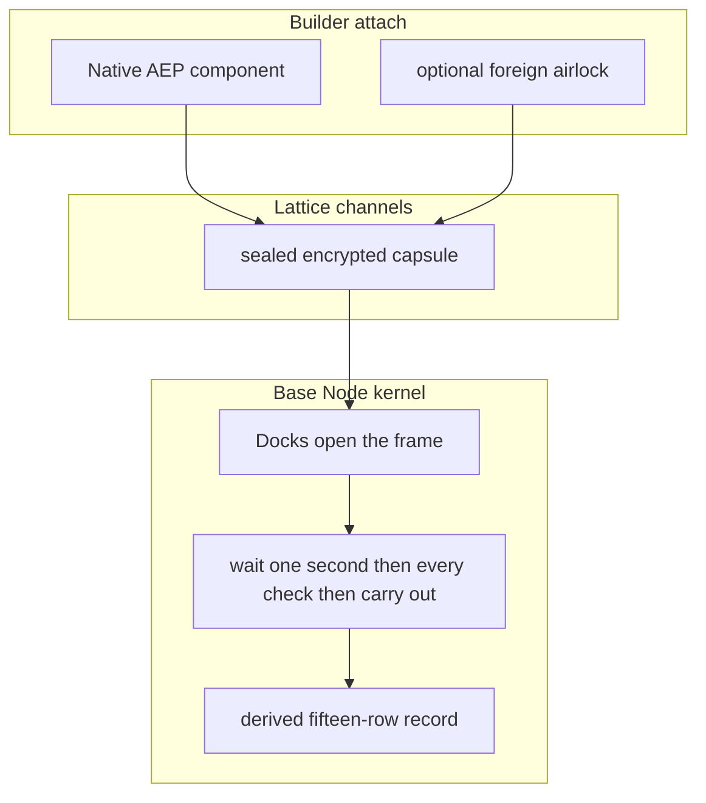

# AEP Hyperlattice

Status: normative. Stability: evolving. It reads the dynAEP registry and the registry catalog, whose shapes still move.

Canonical hyperlattice implementation for AEP 2.9.

| Module | Purpose |
|--------|---------|
| `lib/hyperlattice.mjs` | Unified hyperlattice view, boot validation, plan overrides |
| `lib/composer-protocol.mjs` | Canvas node/edge protocol constraints |
| `lib/gap-constrained-engine.mjs` | GAP policy loading. Optional remote validate uses a GAP engine URL from the environment only when one is set |
| `lib/cca-writing-validator.mjs` | EPSCOM writing.gap enforcement on hyperlattice output |
| `lib/cca-governed-release.mjs` | Governed release pipeline for hyperlattice chat/topology |

This package is the JavaScript projection of the live graph, because the live graph state is owned by the dynamic engine at `AEP-Components/dynAEP/`. The composer canvas reads the projection held by `AEP-Components/hyperlattice/lib/graph-store.mjs`, so no second package owns a private state copy.

## One wrap around every system

One mechanism wraps around every critical application, component, system or engine. Written policy, action paths, scene topology, capability dimensions, compliance docks and sealed transport are nodes and edges in that same graph, a unified policy wrap mechanism. No other protocol has the same kind of solution.

The AEP Base Node runs every check together for that action path and only then emits the signal for the AI to carry out the allowed action. A missing scene, dock, timestamp or sequence fails automatically. 

### Node families in the hyperlattice

| Node family | Role in the hyperlattice graph |
|-------------|----------------------|
| Structure | What exists, its position and its depth band or domain |
| Event | Action paths: parents, constraints, who may act and over which hooks |
| Written policy | Checks bound to a wrap or to an action-path prefix. Writing and security stay on for every action |
| Regulation | Compliance modules such as EU AI Act, GDPR and SOC 2 wait on the regulation dock |
| Transport | Every crossing of the wrap is a sealed encrypted data transport capsule |
| Canvas | Visual projection of the same graph: hub, docks, agents and connectors |

### Wrap composition

```
SYSTEM (most permissive)
  |-- governance
  |-- deployment
  |-- writing
  |-- security
  |-- compliance modules
  |-- action-path nodes
SANDBOX (most restrictive)
```

All applicable nodes must pass together. Who may do what is written per agent, so agent A may perform action "X" and agent B may perform action "Y" with no rank and the isolation of execution boxes remains isolation rather than a trust rank. We have removed the rank ladder as a concept from AEP, because our mechanism is now better and enables more fine-tuned control that bioinsecure protocol designs do not match.

### One crossing path

Seal a data transport capsule, then run every check together and only then carry out the allowed action. See [Kernel pulse](../base-node-pulse/README.md) for the wait period after the capsule seal. TypeScript event helpers are not a second kernel. 



Operator rule: one hyperlattice declaration per governed system. Scene plus action paths plus written policy plus dock channels. Anything less is a broken wrap.

### One kernel sequence

The kernel sequence is seal, freeze, wait, collect-all Admit then Apply so live-entry is the worked scene. TypeScript processEvent is not product Admit. The domain you attach is not a second kernel so the instruction is the next section.
