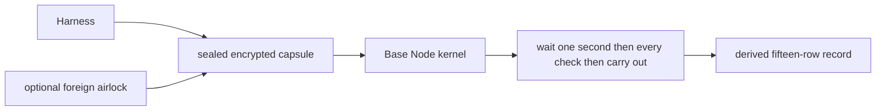

# Lattice Channels (unified)

Status: normative. Stability: evolving. Frame sealing calls the aep-lattice-log binary; lattice-gated-fetch .ts, .mjs and .js keep the same exports.

Single AEP component for lattice channel transport, TypeScript client helpers and the Rust `aep-lattice-channel` crate.

- `lib/` - MJS/TS transport (`latticeGatedFetch`, frame builder)
- `client/` - TypeScript client re-exports
- `crate/` - Rust lattice channel implementation

Compiled AI: deterministic frame contracts; no runtime LLM in this layer.

## Kernel pulse after the sealed capsule

Lattice Channels carry the sealed capsule. They do not own the wait. After the seal is verified the capsule waits 1000 ms on the Base Node clock with time frozen at seal. There is no `pulse_ms` transport field. See `AEP-Base-Node/README.md` for the compiled constant and the theoretical rebuild path. TypeScript dynAEP remains a standalone component.

## LatticeChannel security (mandatory)

Every software development kit, editor and runtime module talks to protocol components only through Lattice Channels: docking sockets carry sealed encrypted capsules and nothing else.

A plain ping, event or register message on the wire is rejected and logged as a side-channel anomaly, meaning an attempt to skip the sealed capsule.

Scene proof at boot checks that the scene graph is structurally valid. That boot proof is not the runtime check. Actions after a sealed capsule is opened are judged in the Base Node kernel.

After the seal is verified, the writing scan and the capsule-hash replay, the capsule waits one second on the Base Node clock. Time is frozen at seal so that one-second hold still fits inside 50 ms of allowed clock drift. The freeze is the Base Node clock, read when the frame arrives. The timestamp an agent seals into its event is compared with that clock and never replaces it, so a stamp more than 50 ms ahead of the Base Node clock is refused before the capsule is queued. The time the seal and the transit take is age and not drift: a stamp up to five seconds behind the Base Node clock is accepted and an older one is refused. A capsule older than five seconds fails. Replay is keyed by the capsule hash so the same sealed bytes cannot be judged twice as a new event.

### Kernel pulse wait

The one-second wait on this path is the kernel pulse. See [Kernel pulse](../base-node-pulse/README.md) for the compiled 1000 ms constant, why dynAEP yaml cannot change it and how a builder can change it in theory by rebuilding Base Node.

A missing scene, dock, timestamp or sequence fails the check. The destination dock may be taken from the opened frame docking port.

When the dock denies, the report names the closed walls and the reasons plus a mechanical repair for missing fields and writing. Grant lists stay off that report. A retry must seal a new capsule because replay is keyed when the capsule is first queued.

Writing walls govern output shape and are not transport security. EPSCOM writing walls stay protocol law at priority 255. Closed walls carry a class of writing, security, temporal, capability, poison or structural so a writing deny is not read as a transport failure.

Putting a capsule on the dock is not the check. After the one-second wait the client asks for the result by the capsule hash on the same dock so a deny names the closed walls and an allow returns an event id.

Base Node can run in a container. Language clients share one sealer for that capsule and do not open a private route.

| Path | Wire format | Notes |
|------|-------------|-------|
| Docking ports | sealed frame only | Plain ping, event and register rejected |
| WASM sandbox | Unix socket `wasm_sandbox` | Evaluate via seal, record and capsule hash |
| Outbound HTTP | Lattice-gated via inference dock | Audit frame before fetch |
| Optional foreign airlock | HTTP/MCP on `:8412` | Only for non-AEP foreign stacks. API-key auth; manifest required; no fallback synthesis |
| Policy | lattice-channel mandatory at boot | Strict lattice at runtime |
