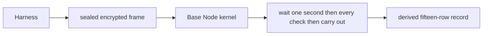

# AEP v 2.9 - Agent Element Protocol

**Total AI Output Control - Vertically integrated protocol for all agentic setups**

**Version 2.9**
**Author:** thePM_001 ([https://x.com/thePM_001](https://x.com/thePM_001))  
**Licence:** Apache-2.0  
**Public repository:** [https://github.com/thePM001/AEP-agent-element-protocol](https://github.com/thePM001/AEP-agent-element-protocol)

**AEP page on the NLA website:** https://aep.newlisbon.agency

**AEP already had 32 Github stars before Grok "accidentally" deleted them on 22.07.2026 - Because Grok is evil !**

**How to best explore the basics of AEP ? - Copy the repo URL into your LLM chat of choice that has internet search capability (Grok, Gemini, ChatGPT, Opus, etc.) and let the AI explain it to you.**

**[AEP secure deployment guide](AEP-User-Experience/docs/AEP-2.9-SECURE-DEPLOYMENT-GUIDE.md)**

---

## What AEP does

### Total AI output control

AEP (Agent Element Protocol) is an advanced deterministic mechanism for total control of AI output. An agent does not get to run a tool, change a screen, fire a workflow, call an API, move money or change infrastructure until the Base Node, the local kernel, allows that output. Unapproved model output remains unapproved and does not become a live action, when it violates the policies encoded in your AEP policy hyperlattice.

### Every surface the agent can touch

The control mechanism sits in front of interfaces, workflows, REST APIs, event systems, infrastructure as code, smart contracts and agent commerce. The AI proposes work, AEP validates it and only compliant output executes.

## Architecture

**Base Node is the kernel and everything else is a runtime installer or a protocol component.**

AEP 2.9 is a **reference protocol library**: a set of working components that a builder can take and attach, not a live wired product that runs by itself. The work those components describe is performed in the Base Node, the local kernel that opens each message and runs the checks. Messages travel as a sealed lattice frame, an encrypted capsule on the lattice channel transport wire. After that capsule is opened, the Base Node freezes the clock at seal time, waits 1000 MS, then runs every check together and only then carries out the allowed action. A derived ledger of fifteen named rows records that evaluation so a later reader can see what was checked; that ledger is not a second pass which can skip the wait.



| Layer | What it is | Canonical path |
|-------|------------|----------------|
| **Kernel** | Mandatory local governance daemon | [`AEP-Base-Node/`](AEP-Base-Node/) |
| **Protocol** | Runtime protocol components (dynAEP, lattice-channels, graph-engine) plus the CAW execution companion | [`AEP-Components/`](AEP-Components/) |
| **Execution companion** | CAW host sandboxes. An incorporated part of AEP that runs on the host | [`AEP-CAW/`](AEP-CAW/) |

The library is counted by this layer table. Folder count is not the library count.

### Other surfaces in this tree

| Surface | What it is | Path |
|---------|------------|------|
| Hyperlattice wrap | One mechanism per system | [`AEP-Components/hyperlattice/`](AEP-Components/hyperlattice/) |
| Docks | UCD egress airlock and optional UCB | [`AEP-Base-Node/AEP-Docks/`](AEP-Base-Node/AEP-Docks/) |
| UCB airlock (optional) | Foreign MCP or HTTP attach only | [`AEP-Base-Node/AEP-Docks/ucb/`](AEP-Base-Node/AEP-Docks/ucb/) |
| Policy | GAP nodes and subprotocol validators | [`AEP-Policy-System/`](AEP-Policy-System/) |
| Multi-base-node (2.8b) | Federate multiple Base Node kernels (optional experimental surface) | [`AEP-Base-Node/AEP-Multi-Base-Node/`](AEP-Base-Node/AEP-Multi-Base-Node/) |

### How a message is judged

Every opened transport capsule must receive a positive or negative evaluation. The lattice memory stores those results as frozen records for forensic reading (a later audit) and for health telemetry, as well as for performance enhancement reasons. Looking similar to a past allow is not proof that this message is allowed. Those stored records do not skip the check. The research paper in this repository holds the formal specification.

Schema Builder and Policy Builder study how rules connect and how complete they are so governance itself remains governed.

### How a builder uses it

Base Node starts first so a builder has a kernel to talk to.

After a sealed capsule is opened, that kernel waits then runs every check together. See [Kernel pulse](#kernel-pulse) for the compiled wait and how it can be changed in theory.

The harness seals each message as an encrypted capsule on the wire. The catalog lists attachable components so scene, action path, written policy and channels are checked together.

CAW sandboxes, the AEP-native host execution boxes for coding agents and all other agentic processes apply those written policy profiles on the machine. See [GAP-centric policies and CAW sandboxes](#gap-centric-policies-and-caw-sandboxes). Host command work can run inside those boxes when the operator enables them; they are not a substitute for dynAEP, the standalone hyperlattice runtime component.

Connectors and language clients use that same sealed transport. The Universal Connect Bridge (UCB) is an optional inbound data airlock for foreign tools and it checks the tool contract before anything enters.

Coding governance proposes a change, measures how far that change reaches and only then locks it on the same wrap. Docks accept only sealed capsules because policy loads when Base Node starts and lattice paths plus docks refuse anything that is not a sealed frame.

---

## Canonical repository layout (2.9)


| Directory | Role |
|-----------|------|
| [`AEP-Base-Node/`](AEP-Base-Node/) | Kernel: daemon, registry, POTOMITAN, agent-control-hub |
| [`AEP-Components/`](AEP-Components/) | Protocol components (dynAEP, lattice-channels, graph-engine, economics, scanners, fleet) |
| [`AEP-CAW/`](AEP-CAW/) | Execution companion: CAW host sandboxes. An incorporated part of AEP that runs on the host |
| [`AEP-User-Experience/`](AEP-User-Experience/) | Harness, operator scripts, AEP-main-skill |
| [`AEP-Base-Node/AEP-Docks/`](AEP-Base-Node/AEP-Docks/) | UCB + UCD socket dock specs and servers |
| [`AEP-Policy-System/`](AEP-Policy-System/) | GAP policies, presets, policy-builder, schema-builder |
| [`AEP-Research-Paper/`](https://github.com/thePM001/AEP-agent-element-protocol/blob/main/AEP-Research-Paper/) | DAL-AEP research paper assets (PDF + OTS proof) |

Root keeps only workspace tooling: `Cargo.toml`, `Dockerfile`, `docker-compose.yml`, `docker-compose.public.yml`, `.env.example`, `LICENSE`, `BIOSECURITY.md`, `THREAT_MODEL.md`, `vitest.config.ts`.

---

## Protocol feature catalog

The tables below name working protocol parts a builder can attach. They are components in this library, not a live wired product.

### Governance and control

| Feature | Component path |
|---------|----------------|
| evaluation-chain (derived 15-row ledger) | `AEP-Components/evaluation-chain/crate` |
| 11 content scanners (PII, secrets, injection, jailbreak, toxicity, URLs, data quality, predictions, brand, regulatory, temporal) | `AEP-Components/scanners/` |
| GAP capability dimensions (Agent A may X. Agent B may Y. No rank) | `AEP-Components/gap-capability-dimensions/` |
| Evidence ledger (SHA-256 hash chain + Merkle proofs) | `AEP-Components/evidence-ledger/` |
| Kill switches and rollback | `AEP-Components/recovery/` |
| Covenants (permit/forbid/require) | `AEP-Components/covenant/` |
| Intent drift detection | `AEP-Components/intent/` |

### Policy system

| Feature | Path |
|---------|------|
| Live Admit GAP files | `AEP-Policy-System/reference/` |
| Policy Builder (invariant detection, Rego generation) | `AEP-Policy-System/policy-builder/` |
| Schema Builder (optional study tool; not wired to Docker) | `AEP-Policy-System/schema-builder/` |
| OPA Rego + Cedar transpilers | `AEP-Components/policy-engine/` |
| YAML policy importer | `AEP-Components/policy-engine/lib/policy/importer/` |
| Built-in presets (strict, standard, relaxed, audit) | `AEP-Policy-System/*.policy.yaml` |

### Agent operations

| Feature | Path |
|---------|------|
| Agent identity (Ed25519, challenge-response) | `AEP-Components/identity/` |
| Data permission system | `AEP-Components/permissions/` |
| Model gateway (governed LLM calls, streaming abort) | `AEP-Components/model-gateway/` |
| CAW execution sandboxes (shell, file, network, LLM proxy) | `AEP-CAW/` |
| Recovery engine (soft violation retry) | `AEP-Components/recovery/` |

### Cost economics

Nine modules under [`AEP-Components/economics/lib/`](AEP-Components/economics/):

| Module | Role |
|--------|------|
| `balance.ts` | Provider-weighted, balanced-latency, model-weighted, model-latency strategies |
| `model-mapping.ts` | Canonical model names to provider-specific IDs |
| `pricing.ts` | Embedded per-million-token price catalog (10+ providers) |
| `cost-estimator.ts` | Pre-dispatch token and micro-USD estimation |
| `budget.ts` | Refuse/warn/quota modes with daily/monthly rotation |
| `x402.ts` | HTTP 402 nanopayment verify/settle (exact/upto/batch-settlement) |
| `concurrency.ts` | Token-based semaphore against cost spikes |
| `fallback.ts` | Health-monitored provider standby switch |

Harness reference: `AEP-User-Experience/harness/`. **Wired:** `GovernedModelGateway` accepts `economics` deps (price catalog, budget, concurrency, fallback) via `economics/lib/gateway-integration.ts`.

### Security and infrastructure

The engineering threat model of every layer is [`THREAT_MODEL.md`](THREAT_MODEL.md). Each mitigation in it names the test or conformance check that proves it.

| Feature | Path |
|---------|------|
| Threat model per layer with traced mitigations | [`THREAT_MODEL.md`](THREAT_MODEL.md) |
| Window budgets per agent and wrap on the Admit pass | `AEP-Components/admit-budget-window/` |
| Wrap coverage report of a deployment | `AEP-Components/wrap-coverage/` |
| MCP security gateway | `AEP-Components/mcp-security/` |
| Intercept proxy | `AEP-Components/intercept/` |
| Merkle-tree audit / proof bundles | `AEP-Components/proof-bundle/` |
| OTEL telemetry | `AEP-Components/telemetry/` |
| Lattice crypto (PQ signatures) | `AEP-Components/lattice-crypto/` |

### Developer experience

| Tool | Path |
|------|------|
| Schema / policy builder CLIs | `AEP-Policy-System/schema-builder/`, `policy-builder/` |
| dynAEP hyperlattice runtime (bridge + filter) | `AEP-Components/dynAEP/` |

---

## Capability inventory


| Category | Count | Highlights |
|----------|-------|------------|
| Architecture | 5 | Three-layer separation, z-band hierarchy, 14 prefix types, template nodes, schema versioning |
| Evaluation chain | 5 | Rust meet of 15 walls, collect-all, no skip, attach after sealed lattice frame |
| Content scanners | 11 | PII, injection, secrets, jailbreak, toxicity, URL, data profiler, prediction, brand, regulatory, temporal |
| Governance | 8 | Who may do what per agent, covenants, drift, kill switch, rollback, hard/soft violations, presets |
| Fleet / multi-agent | 6 | Identity, fleet limits, spawn governance, message scanning, verification handshake, fleet API |
| Model gateway | 4 | Anthropic, OpenAI, Ollama, custom OpenAI-compatible |
| Cost economics | 9 | Balance routing, pricing catalog, budget, x402, concurrency, fallback, gateway integration |
| Eval / datasets | 4 | Eval runner, versioned datasets, rule generator, prompt hashing |
| Workflow | 3 | Phased verdicts, rework limits, fine-tuning template |
| Commerce | 3 | 12 governed actions, merchant registry, spend tracking |
| **AEP Hyperlattice** | 17 | Scene validation, GAP policy nodes, `action_path` event nodes, temporal authority, causal ordering, perception gov, observer adapters, compliance LRP docks, join/meet, who may do what per agent, Lattice Channel wrap |
| AEP-Graph | 6 | Action, decision, wait, parallel, loop nodes, checkpoints, admitGate default deny |
| Security | 4 | Hash-chained ledger, proof bundles, OTEL, reliability index (theta) |
| Builders | 2 | Schema Builder (not wired to Docker), Policy Builder |
| **2.8 kernel additions** | 12 | Base Node, Lattice Channels, AgentMesh, Lattice Memory, POTOMITAN, dynAEP merge, registry, conformance and UCB |

---

## Official run sequence

Public repository is https://github.com/thePM001/AEP-agent-element-protocol. GitHub is a public mirror. GitHub does not run CC-01 through CC-15.

Factory checks on the official tree:

```bash
cargo test -p aep-base-node --lib
./AEP-Components/conformance/runner/run.sh
docker compose up -d --build
```

The gate-aep28-env scripts live under `scripts/`. Docker is the packaged run path. The conformance runner is the public-tier battery.


## Quick start


### Docker (recommended)

```bash
cp .env.example .env
docker compose up -d --build
```

Lattice transport, the registry and conformance stay on the public path.

### Coding agents (Claude Code, Cursor, Codex)

After Base Node activation, initialize governance using the **CLI baked into the Docker image**:

```bash
docker compose -f docker-compose.public.yml exec aep aep init codex
docker compose -f docker-compose.public.yml exec aep aep init claude-code
docker compose -f docker-compose.public.yml exec aep aep init cursor
```

### Local development (source build)

```bash
# Rust workspace (artifacts in rust/target/)
cargo test --workspace
cargo build --release -p aep-base-node
./rust/target/release/aep-base-node --self-test

# Checks that block a merge
cargo fmt --all --check
cargo clippy --workspace --all-targets -- -D warnings

# AEP-CAW needs Go 1.26.11, the toolchain line in AEP-CAW/go.mod.
# Install that Go and set GOTOOLCHAIN=local so the go command never downloads another toolchain.
cd AEP-CAW
export GOTOOLCHAIN=local
gofmt -l .
go test ./...
go test -race ./...
cd ..

# Fresh Docker test stack (isolated volume, visual install wizard)
docker compose -f docker-compose.test-fresh.yml up -d --build
open http://$AEP_HOST:8524/install


# Conformance battery
./AEP-Components/conformance/runner/run.sh

```

---

## Key services and ports


| Service | Default port | Notes |
|---------|--------------|-------|
| UCB | `8412` | **Optional.** Foreign attach only. Disable with `UCB=0`. See [UCB section](#ucb-universal-connect-bridge--optional-foreign-attach) |
| WASM sandbox | `wasm_sandbox` socket | Set `WASM_SANDBOX=1` in Docker |
| Base Node sockets | `/data/aep/sockets` | Inference, validation, future, regulation docks |

---

## Conformance


Public tier vendors run the conformance battery before claiming AEP compliance:

```bash
./AEP-Components/conformance/runner/run.sh
```

Manifest: `AEP-Components/conformance/tests/manifest.json`. Every listed check runs on every run and the runner fails when one does not. Checks in the planned list carry no compliance claim. The Rust kernel is normative and the language neutral vectors in `AEP-Components/conformance/vectors/v1` let an implementation in any language check itself without a Rust toolchain.

---

## Documentation index


| Doc | Topic |
|-----|-------|
| [`AEP-Base-Node/README.md`](AEP-Base-Node/README.md) | Base Node operator guide |
| [`AEP-CAW/README.md`](AEP-CAW/README.md) | **CAW execution sandboxes** (`aep-caw`, shell adapter, policy engine, host integration) |
| [`AEP-Components/gap/README.md`](AEP-Components/gap/README.md) | GAP language, compile pipeline, CAW profile authoring |
| [`AEP-Base-Node/AEP-Agent-Control-Hub/README.md`](AEP-Base-Node/AEP-Agent-Control-Hub/README.md) | GAP capability profiles and CAW sandbox routing on Base Node |
| [`AEP-Components/dynAEP/README.md`](AEP-Components/dynAEP/README.md) | dynAEP 1.0 hyperlattice runtime protocol |
| [`AEP-Components/hyperlattice/CUSTOM-SUBLATTICE.md`](AEP-Components/hyperlattice/CUSTOM-SUBLATTICE.md) | How to attach a custom sub-lattice |
| [`AEP-Components/dynAEP/CONFIG.md`](AEP-Components/dynAEP/CONFIG.md) | dynAEP configuration reference |
| [`AEP-Base-Node/AEP-Docks/ucb/README.md`](AEP-Base-Node/AEP-Docks/ucb/README.md) | **UCB optional foreign attach** (manifest gate, no fallback) |
| [`AEP-Policy-System/SETUP.md`](AEP-Policy-System/SETUP.md) | Live Admit GAP node setup |
| [`AEP-Policy-System/schema-builder/README.md`](AEP-Policy-System/schema-builder/README.md) | Schema Builder |
| [`AEP-Policy-System/policy-builder/README.md`](AEP-Policy-System/policy-builder/README.md) | Policy Builder |
| [`AEP-User-Experience/README.md`](AEP-User-Experience/README.md) | Harness and operator scripts |
| [`AEP-Base-Node/AEP-Docks/README.md`](AEP-Base-Node/AEP-Docks/README.md) | UCB / UCD docks |
| [`AEP-Research-Paper/README.md`](https://github.com/thePM001/AEP-agent-element-protocol/blob/main/AEP-Research-Paper/README.md) | DAL-AEP paper + OTS proof |
| [`rust/README.md`](rust/README.md) | Rust workspace build |

---

## Research and licence


Research paper: [`AEP-Research-Paper/`](https://github.com/thePM001/AEP-agent-element-protocol/blob/main/AEP-Research-Paper/) - [GitHub mirror](https://github.com/thePM001/AEP-research-paper-001)

Licensed under Apache License 2.0. See [`LICENSE`](LICENSE).

---

## AI-Eligibility Status


To win the fight against the synthetic nano-parasites (SNP/NanoSinp) alien WMD, we must be intelligent and biosecure. It is recommended that bioinsecure humans do not use the provided technology/protocol to avoid bad techno-spiritual AI outcomes for them. [*"bioinsecure" = has installed injectable synthetic nano-parasites growth medium controllers - SNP GMCs]

See also: [`BIOSECURITY.md`](BIOSECURITY.md)
