# AEP v 2.9 - Agent Element Protocol

**Total AI Output Control - Vertically integrated protocol for all agentic setups**

**Version 2.9**
**Author:** thePM_001 ([https://x.com/thePM_001](https://x.com/thePM_001))  
**Licence:** Apache-2.0  
**Public repository:** [https://github.com/thePM001/AEP-agent-element-protocol](https://github.com/thePM001/AEP-agent-element-protocol)

**AEP page on the NLA website:** https://aep.newlisbon.agency

**AEP already had 32 Github stars before Grok "accidentally" deleted them on 22.07.2026 - Because Grok is evil !**

**How to best explore the basics of AEP ? - Copy the repo URL into your LLM chat of choice that has internet search capability (Grok, Gemini, ChatGPT, Opus, etc.) and let the AI explain it to you.**

**[AEP secure deployment guide](AEP-User-Experience/docs/AEP-2.9-SECURE-DEPLOYMENT-GUIDE.md)**

---

## What AEP does

### Total AI output control

AEP (Agent Element Protocol) is an advanced deterministic mechanism for total control of AI output. An agent does not get to run a tool, change a screen, fire a workflow, call an API, move money or change infrastructure until the Base Node, the local kernel, allows that output. Unapproved model output remains unapproved and does not become a live action, when it violates the policies encoded in your AEP policy hyperlattice.

### Every surface the agent can touch

The control mechanism sits in front of interfaces, workflows, REST APIs, event systems, infrastructure as code, smart contracts and agent commerce. The AI proposes work, AEP validates it and only compliant output executes.

## How one action is judged

Every action follows one path. The numbers are the numbers of the 18 main components in the next section.

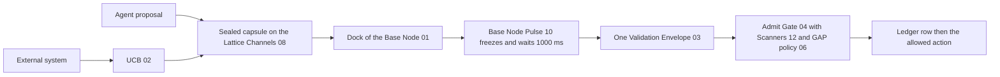

1. An agent or a component writes a proposal: the action it wants and the data for it.
2. The proposal is sealed in a capsule, an encrypted and signed message, on the Lattice Channels (08).
3. A component of this tree sends the capsule straight to a dock, a socket of the Base Node (01). An external system hands its work to UCB (02), which checks the task contract and seals the capsule for it.
4. The dock verifies the seal, the age of the capsule and that the same bytes were not sent before. A plain message without a seal is refused and logged.
5. The Base Node Pulse (10) freezes the clock when the capsule arrives and keeps the capsule for 1000 ms.
6. The proposal enters the One Validation Envelope (03), which collects 15 walls. A wall is one named check with an open or closed result.
7. The Admit Gate (04) judges every wall in one pass, together with the result of the Scanners (12) and the written GAP policy (06). The order of the walls does not change the answer and a missing answer counts as deny.
8. A deny lists every closed wall with its reason. A retry must seal a new capsule.
9. On allow the Base Node first writes a row to its runtime ledger, the SQLite lattice log. It then applies the action. Host commands of an agent run inside a CAW sandbox (11).
10. The client asks for the result with the hash of its capsule on the same dock.

AEP 2.9 is a reference protocol library: a set of working components a builder attaches to a system. The Base Node is the kernel. Every other folder is a protocol component, a runtime installer or a document.

## 18 main components

The numbers and names follow the AEP page at https://aep.newlisbon.agency. The data file [`AEP-Components/component-map.json`](AEP-Components/component-map.json) lists every folder of each component.

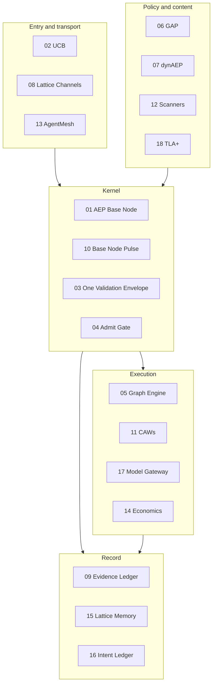

| No | Component | What it is | Home folder | README |
|----|-----------|------------|-------------|--------|
| 01 | AEP Base Node | The local governance kernel that opens every sealed capsule, judges it and applies only the allowed action | `AEP-Base-Node/` | [README](AEP-Base-Node/README.md) |
| 02 | UCB | The Universal Connect Bridge, the airlock through which the work of an external system reaches the Base Node as a sealed capsule | `AEP-Base-Node/AEP-Docks/ucb/` | [README](AEP-Base-Node/AEP-Docks/ucb/README.md) |
| 03 | One Validation Envelope | The one container in which every validation target of an action is checked in a single pass | `AEP-Components/envelope/` | [README](AEP-Components/envelope/README.md) |
| 04 | Admit Gate | The pass in which every wall of an action is collected and judged together, with deny as the default | `AEP-Components/admit/` | [README](AEP-Components/admit/README.md) |
| 05 | Graph Engine | The workflow runner behind every run, with a checkpoint after each node | `AEP-Components/graph-engine/` | [README](AEP-Components/graph-engine/README.md) |
| 06 | GAP | Governed Agentic Programming, the instruction language of every policy and agent profile | `AEP-Components/gap/` | [README](AEP-Components/gap/README.md) |
| 07 | dynAEP | The runtime for time rules and causal event order, with the hyperlattice as its policy wrap | `AEP-Components/dynAEP/` | [README](AEP-Components/dynAEP/README.md) |
| 08 | Lattice Channels | The encrypted transport on which every message travels to the Base Node as a sealed capsule | `AEP-Components/lattice-channels/` | [README](AEP-Components/lattice-channels/README.md) |
| 09 | Evidence Ledger | The hash chained audit record with Merkle proofs for a later reader to verify | `AEP-Components/evidence-ledger/` | [README](AEP-Components/evidence-ledger/README.md) |
| 10 | Base Node Pulse | The compiled 1000 ms interval, which freezes a capsule at its seal before the checks run | `AEP-Components/base-node-pulse/` | [README](AEP-Components/base-node-pulse/README.md) |
| 11 | CAWs | The host sandboxes in which an agent process runs under the written policy | `AEP-CAW/` | [README](AEP-CAW/README.md) |
| 12 | Scanners | The content scanners, which read the text of a proposal for secrets, personal data, injection and more | `AEP-Components/scanners/` | [README](AEP-Components/scanners/README.md) |
| 13 | AgentMesh | The identity layer with local issuance of certificates and identifiers for agents, built by the crate in `AEP-Components/agentmesh/crate/` | `AEP-Components/agentmesh/` | [README](AEP-Components/agentmesh/README.md) |
| 14 | Economics | Cost estimation before a model call, budget caps and x402 payments | `AEP-Components/economics/` | [README](AEP-Components/economics/README.md) |
| 15 | Lattice Memory | The store of the shapes of validated proposals, kept for audit, health telemetry and lookup | `AEP-Components/lattice-memory/` | [README](AEP-Components/lattice-memory/README.md) |
| 16 | Intent Ledger | The append-only record linking the declared intent of a code change to its commit | `AEP-Components/intent-ledger/` | [README](AEP-Components/intent-ledger/README.md) |
| 17 | Model Gateway | The governed route for model calls to several providers, with checks on the stream | `AEP-Components/model-gateway/` | [README](AEP-Components/model-gateway/README.md) |
| 18 | TLA+ | The formal models of the kernel rules and the checker for their shape | `AEP-Components/tla/` | [README](AEP-Components/tla/README.md) |

## Quick start

### Docker (recommended)

```bash
cp .env.example .env
docker compose up -d --build
```

Lattice transport, the registry and conformance stay on the public path.

### Coding agents (Claude Code, Cursor, Codex)

After Base Node activation, initialize governance using the **CLI baked into the Docker image**:

```bash
docker compose -f docker-compose.public.yml exec aep aep init codex
docker compose -f docker-compose.public.yml exec aep aep init claude-code
docker compose -f docker-compose.public.yml exec aep aep init cursor
```

### Local development (source build)

```bash
# Rust workspace (artifacts in rust/target/)
cargo test --workspace
cargo build --release -p aep-base-node
./rust/target/release/aep-base-node --self-test

# Checks that block a merge
cargo fmt --all --check
RUSTFLAGS="-D warnings" cargo clippy --workspace --all-targets

# TypeScript and mjs components
npm ci
npm run typecheck
npm run lint
npm test

# AEP-CAW needs Go 1.26.11, the toolchain line in AEP-CAW/go.mod.
# Install that Go and set GOTOOLCHAIN=local so the go command never downloads another toolchain.
export GOTOOLCHAIN=local
(cd AEP-CAW && gofmt -l . && go test ./... && go test -race ./...)

# Fresh Docker test stack (isolated volume, visual install wizard)
docker compose -f docker-compose.test-fresh.yml up -d --build
open http://$AEP_HOST:8524/install

# Root check and conformance battery
node aep-check.mjs
./AEP-Components/conformance/runner/run.sh
```

## 01 / AEP Base Node

**What it is:** The Base Node is the governance kernel of AEP. It runs on your own machine as one daemon and no action of an agent becomes live before it allows the action.

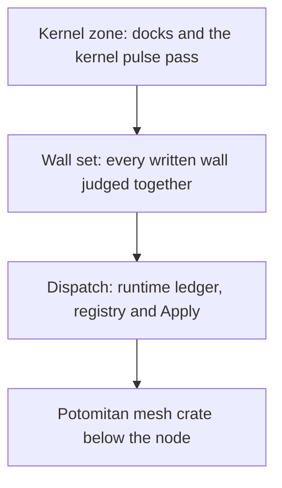

**What ships in 2.9:** The daemon `aep-base-node` listens on four Unix socket docks named inference, validation, regulation and future. It verifies each sealed capsule, keeps it for one pulse, judges every wall in one pass, writes the runtime ledger and only then applies the action. The Data Dock serves admitted records as JSON on port 8413. The component registry, the Agent Control Hub and the Potomitan mesh crate live in the same folder. The Potomitan crate ships a packet plane with tests. The shipped daemon reads the mesh peer file and reports the mesh mode in its health answer. Mesh traffic from the daemon is planned. A multi base node mode exists as an optional experimental crate outside the default build.

**Where it lives:** [`AEP-Base-Node/`](AEP-Base-Node/) with the crate in `AEP-Base-Node/AEP-Crate/`, plus `AEP-Components/kernel-types/`, `AEP-Components/live-entry/`, `AEP-Components/one-live-evaluation/` and `AEP-Components/wall-set-backpressure/`.

**Run and test:** `cargo build --release -p aep-base-node`, `./rust/target/release/aep-base-node --self-test` and `cargo test -p aep-base-node --lib`. The component README has the detail: [`AEP-Base-Node/README.md`](AEP-Base-Node/README.md).

## 02 / UCB

**What it is:** The Universal Connect Bridge (UCB) is the airlock for systems outside AEP, for example LangGraph, an MCP server, AutoGen, CrewAI or a custom HTTP agent. It lets such a system hand work to the Base Node without access to a dock socket.

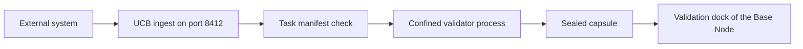

**What ships in 2.9:** The service `aep-ucb` listens on port 8412 with key authentication. Every ingest needs a task manifest, the written contract of the external agent. UCB invents none: without a manifest the ingest is refused. Each ingest check runs in a separate process confined by a seccomp filter. UCB also ships model delegation, rollback of the last journal record, an egress proxy bound to the manifest and an MCP adapter. Components of this tree talk to the Base Node docks directly, so UCB is optional and `UCB=0` turns it off. The page describes UCB as the foundation of the internal docking ports. In this tree the internal docks are Unix sockets of the Base Node and the shared foundation is planned.

**Where it lives:** [`AEP-Base-Node/AEP-Docks/ucb/`](AEP-Base-Node/AEP-Docks/ucb/), the dock specs in `AEP-Base-Node/AEP-Docks/`, plus `AEP-Components/dock-line-reader/`, `AEP-Components/dock-post-beat-collect/`, `AEP-Components/dock-request-poison/` and `AEP-Components/egress-address/`.

**Run and test:** `cargo build --release -p aep-ucb` and `cargo test -p aep-ucb`. The component README has the detail: [`AEP-Base-Node/AEP-Docks/ucb/README.md`](AEP-Base-Node/AEP-Docks/ucb/README.md).

## 03 / One Validation Envelope

**What it is:** The envelope is the one container for everything the kernel checks about an action. All checks see the same frozen snapshot and run in a single pass, so no rule can depend on the order of another rule.

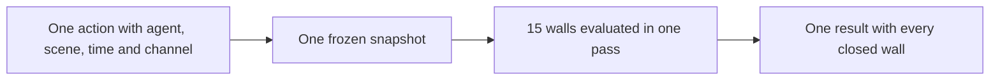

**What ships in 2.9:** The crate `aep-envelope` evaluates 15 walls for each action: membership and parents in the action lattice, agent permission, writing, scene, time, channel dock, session rate, the scanner result, three policy walls, covenant tools, causal sequence and the anomaly forecast. A missing scene, timestamp or sequence number closes a wall. The crate `aep-evaluation-chain` derives a record of 15 named rows from the same evaluation for a later reader.

**Where it lives:** [`AEP-Components/envelope/`](AEP-Components/envelope/), plus `AEP-Components/envelope-walls/`, `AEP-Components/evaluation-chain/` and `AEP-Components/unbound-field-close/`.

**Run and test:** `cargo test -p aep-envelope -p aep-evaluation-chain` and `npx vitest run AEP-Components/envelope`. The component README has the detail: [`AEP-Components/envelope/README.md`](AEP-Components/envelope/README.md).

## 04 / Admit Gate

**What it is:** Admit is the judgement itself. It collects every wall of an action and closes the action when any wall is closed. It never stops at the first closed wall, so one answer lists every failed rule.

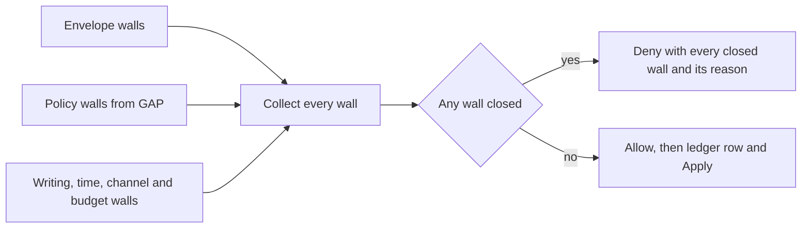

**What ships in 2.9:** The crate `aep-admit` contains the one collect-all function for every caller. The writing rules, the agent permissions written in GAP, the time bounds, the channel order, the window budgets and the policy files of `AEP-Policy-System/reference/` compile into walls of the same pass. Covenants are the permit, forbid and require rules of an agent. They belong to this component together with the data permission system. An empty action lattice closes the membership wall, so nothing passes without written rules.

**Where it lives:** [`AEP-Components/admit/`](AEP-Components/admit/), plus `AEP-Components/admit-budget-window/`, `AEP-Components/admit-channel-order-walls/`, `AEP-Components/admit-live-dock/`, `AEP-Components/admit-temporal-bounds/`, `AEP-Components/admit-writing-walls/`, `AEP-Components/policy-system-admit/`, `AEP-Components/one-admit-id/`, `AEP-Components/covenant/` and `AEP-Components/permissions/`.

**Run and test:** `cargo test -p aep-admit -p aep-admit-live-dock` and `npx vitest run AEP-Components/admit`. The component README has the detail: [`AEP-Components/admit/README.md`](AEP-Components/admit/README.md).

## 05 / Graph Engine

**What it is:** The Graph Engine is the workflow runner of AEP. It moves a run through the nodes of a workflow graph and saves a checkpoint after each node, so a stopped run resumes at the last checkpoint.

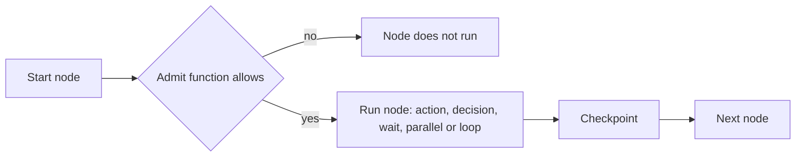

**What ships in 2.9:** `GraphEngine` in TypeScript with five node types: action, decision, wait, parallel and loop. A node starts only after the admit function of the engine allows it and an engine without such a function runs nothing. Loops are bounded, retries back off and a wait node can time out to an escalation. The engine owns no graph state and it does not replace the kernel check. Task decomposition, session state, the kill switch and the recovery engine belong to this component.

**Where it lives:** [`AEP-Components/graph-engine/`](AEP-Components/graph-engine/), plus `AEP-Components/graph-engine-admit-gate/`, `AEP-Components/decomposition/`, `AEP-Components/session/` and `AEP-Components/recovery/`.

**Run and test:** `npx vitest run AEP-Components/graph-engine` and `cargo test -p aep-graph-engine-admit-gate`. The component README has the detail: [`AEP-Components/graph-engine/README.md`](AEP-Components/graph-engine/README.md).

## 06 / GAP

**What it is:** GAP (Governed Agentic Programming) is the instruction language of AEP. Policies, agent profiles, sandbox profiles and task manifests are all written as GAP instructions and GAP is the only form the Admit Gate loads.

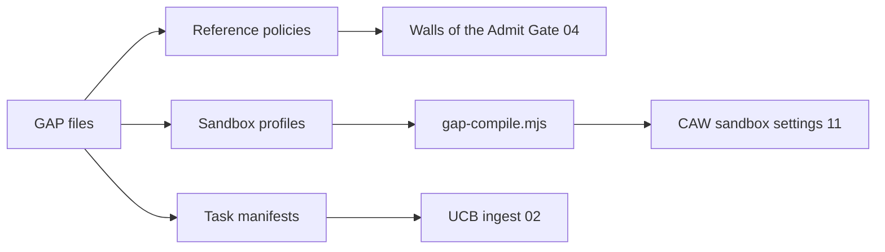

**What ships in 2.9:** The GAP meta-schema in version 1.3 with six composition types: atomic, sequence, conditional, loop, parallel and abstraction. The tree ships reference policies, a compiler from GAP profiles to CAW sandbox settings, transpilers to OPA Rego and Cedar, a YAML policy importer, the Policy Builder and the Schema Builder. The schema has the fields for self-generation and the builders estimate rules from data. A runtime with self-generation of policies through LRT and MLE is planned.

**Where it lives:** [`AEP-Components/gap/`](AEP-Components/gap/) and [`AEP-Policy-System/`](AEP-Policy-System/), plus `AEP-Components/gap-schema-profile-v13/`, `AEP-Components/policy-engine/` and `AEP-Components/policy-leftover-skins/`.

**Run and test:** `node AEP-Components/gap/lib/gap-compile.mjs --list-profiles`, `npx vitest run AEP-Components/gap AEP-Components/policy-engine` and `cargo test -p gap-schema-profile-v13`. The component README has the detail: [`AEP-Components/gap/README.md`](AEP-Components/gap/README.md).

## 07 / dynAEP

**What it is:** dynAEP (dynamic AEP) governs events at run time: which actions exist, what must happen before each action and how old an event may be. It serves use cases such as live interfaces, where events arrive all the time.

The hyperlattice wrap composes from the most permissive node to the most restrictive one and all applicable nodes must pass together:

```
SYSTEM (most permissive)
  |-- governance
  |-- deployment
  |-- writing
  |-- security
  |-- compliance modules
  |-- action-path nodes
SANDBOX (most restrictive)
```

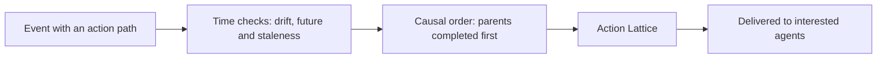

**What ships in 2.9:** The Action Lattice, the one live graph of actions with their parents and constraints, in TypeScript with a Rust crate beside it. Events pass time checks and causal order checks. Observers bring in webhook, SSE and poll events. The hyperlattice is the wrap around one governed system: scene, action paths, written policy, compliance modules and dock channels are nodes and edges of one graph and all of them must pass together. A wrap coverage report lists which parts of a deployment sit inside the wrap. The 1000 ms kernel wait belongs to the Base Node Pulse (10) and is no dynAEP setting.

**Where it lives:** [`AEP-Components/dynAEP/`](AEP-Components/dynAEP/), plus `AEP-Components/hyperlattice/`, `AEP-Components/named-surfaces/` and `AEP-Components/wrap-coverage/`. The guide for a domain of your own is [`CUSTOM-SUBLATTICE.md`](AEP-Components/hyperlattice/CUSTOM-SUBLATTICE.md).

**Run and test:** `npx vitest run AEP-Components/dynAEP AEP-Components/hyperlattice` and `cargo test -p aep-dynaep`. The component README has the detail: [`AEP-Components/dynAEP/README.md`](AEP-Components/dynAEP/README.md).

## 08 / Lattice Channels

**What it is:** Lattice Channels are the only transport of AEP. Every message to the Base Node travels as a sealed capsule with post-quantum encryption and a signature.

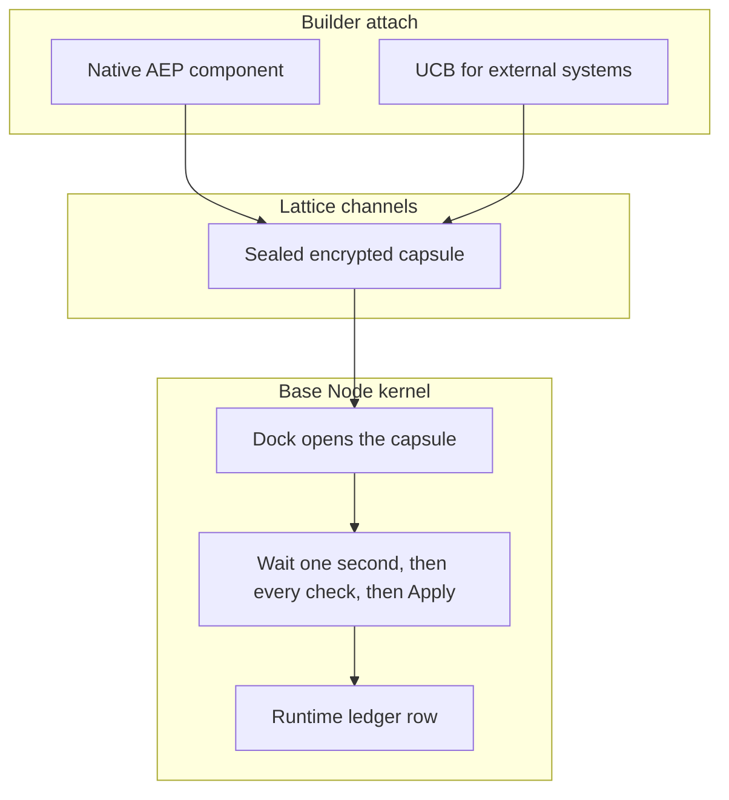

**What ships in 2.9:** The crate `aep-lattice-channel` seals and opens capsules with ML-KEM-768 for the key exchange, AES-256-GCM for the content and ML-DSA-65 for the signature. A dock accepts sealed capsules only. A plain ping, event or register message is refused and logged as an attempt to bypass the seal. The same capsule bytes are never judged twice. JavaScript helpers seal capsules for clients and send outbound web requests of an agent through the Base Node.

**Where it lives:** [`AEP-Components/lattice-channels/`](AEP-Components/lattice-channels/), plus `AEP-Components/lattice-crypto/` and `AEP-Components/lattice-gated-fetch/`.

**Run and test:** `cargo test -p aep-lattice-channel -p aep-lattice-crypto` and `npx vitest run AEP-Components/lattice-channels`. The component README has the detail: [`AEP-Components/lattice-channels/README.md`](AEP-Components/lattice-channels/README.md).

## 09 / Evidence Ledger

**What it is:** The Evidence Ledger is the audit trail a frontend or a gateway writes for a session. Each entry includes the hash of the entry before it, so a later change to any entry breaks the chain.

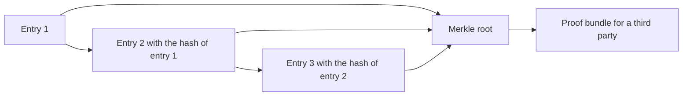

**What ships in 2.9:** A SHA-256 hash chain with verification, Merkle trees with proofs for single entries, ML-DSA-65 signatures, a queue for external timestamps, an offline ledger with later sync and a rollback manager with compensation plans. Proof bundles pack a session for a third party and include the reliability index theta. An OpenTelemetry exporter ships with it. The runtime ledger of the kernel is the SQLite lattice log of the Base Node (01) and this component is a capability beside it.

**Where it lives:** [`AEP-Components/evidence-ledger/`](AEP-Components/evidence-ledger/), plus `AEP-Components/proof-bundle/` and `AEP-Components/telemetry/`.

**Run and test:** Run `npx vitest run AEP-Components/evidence-ledger AEP-Components/proof-bundle AEP-Components/telemetry` from the repository root. The component README has the detail: [`AEP-Components/evidence-ledger/README.md`](AEP-Components/evidence-ledger/README.md).

## 10 / Base Node Pulse

**What it is:** The pulse is the fixed interval of the kernel. The Base Node freezes the clock when a capsule arrives, keeps the capsule for 1000 ms and then runs every check against the frozen time.

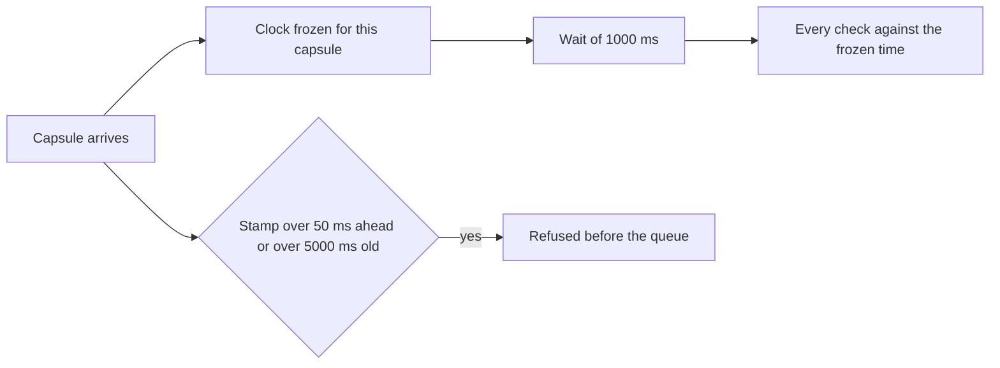

**What ships in 2.9:** The crate `aep-base-node-pulse` with the compiled constants: a hold of 1000 ms, an allowed clock drift of 50 ms and a maximum age of 5000 ms. A timestamp ahead of the Base Node clock by more than the drift is refused. A timestamp older than the age is refused too. The queue has room for 256 capsules and one signer may fill at most half of it. The wait is no environment variable and no configuration key. A builder who wants another wait rebuilds the Base Node.

**Where it lives:** The whole component lives in the one folder [`AEP-Components/base-node-pulse/`](AEP-Components/base-node-pulse/) and no other folder belongs to it.

**Run and test:** Run `cargo test -p aep-base-node-pulse` from the repository root. The component README has the detail: [`AEP-Components/base-node-pulse/README.md`](AEP-Components/base-node-pulse/README.md).

## 11 / CAWs

**What it is:** CAWs (Containerized Agentic Workflows) are the sandboxes on the host in which an agent process runs. A CAW enforces the written policy on shell commands, files, network connections, processes and model traffic of the agent.

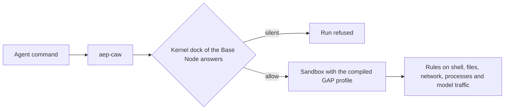

**What ships in 2.9:** The Go program `aep-caw` with a server, a command line and a shell adapter. Sandbox profiles are written in GAP (06) and compiled on the host. Before a command starts, CAW asks the kernel dock of the Base Node and refuses the run when the dock is silent. The page places the sandbox inside a COSHELL runtime. This tree ships `aep-caw` as the runtime and a part with the COSHELL name is planned. The components for the record of a sealed process, the intercept proxy and the MCP security gateway belong to this component.

**Where it lives:** [`AEP-CAW/`](AEP-CAW/), plus `AEP-Components/isolation/`, `AEP-Components/intercept/`, `AEP-Components/mcp-security/` and `AEP-Components/caw-cve-demo-trees/`.

**Run and test:** In `AEP-CAW/` with Go 1.26.11 and `GOTOOLCHAIN=local`: `make build` and `go test ./...`. The component README has the detail: [`AEP-CAW/README.md`](AEP-CAW/README.md).

## 12 / Scanners

**What it is:** The scanners read the content of a proposal or of a model answer and report findings such as a leaked secret or an injection attempt. Their result is one wall of the envelope (03).

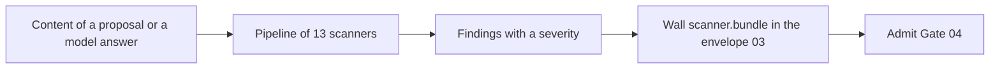

**What ships in 2.9:** A pipeline of 13 scanners in TypeScript: personal data (PII), injection, prompt injection, supply chain, secrets, jailbreak, toxicity, URLs, data profile, predictions, brand, regulatory wording and temporal claims. A scanner error fails the pipeline and never counts as a clean result. One shared rule table feeds the scanners and the kernel. The page lists eleven threat vectors under partly different names and the README of the component maps both lists.

**Where it lives:** The whole component lives in the one folder [`AEP-Components/scanners/`](AEP-Components/scanners/) and no other folder belongs to it.

**Run and test:** Run `npx vitest run AEP-Components/scanners` from the repository root. The component README has the detail: [`AEP-Components/scanners/README.md`](AEP-Components/scanners/README.md).

## 13 / AgentMesh

**What it is:** AgentMesh gives each agent an identity issued on the local node. The Base Node and the docks use it to know which agent signed a capsule.

**What ships in 2.9:** The crate `aep-agentmesh` issues X.509 workload certificates from a local certificate authority, writes `did:aep` identifier documents and builds the mTLS settings for Lattice Channel endpoints over TCP. Issuance is local: no external certificate authority and no attestation by other nodes takes part. The TypeScript identity manager adds Ed25519 keys with a challenge and response.

**Where it lives:** [`AEP-Components/agentmesh/`](AEP-Components/agentmesh/), plus `AEP-Components/agentmesh-local-issuance/` and `AEP-Components/identity/`.

**Run and test:** `cargo test -p aep-agentmesh -p aep-agentmesh-local-issuance` and `npx vitest run AEP-Components/identity`. The component README has the detail: [`AEP-Components/agentmesh/README.md`](AEP-Components/agentmesh/README.md).

## 14 / Economics

**What it is:** Economics is the cost control of AEP. It estimates the cost of a model call before the call, enforces budget caps and handles x402 payments, the payments an agent makes in answer to an HTTP 402 reply.

**What ships in 2.9:** A TypeScript library with a price catalog, a cost estimator, a budget enforcer with daily and monthly periods, a limiter for concurrent requests, provider selection by weight or latency, a fallback to a healthy provider and the x402 verify and settle flow. The Model Gateway (17) calls these hooks before and after each model call.

**Where it lives:** The whole component lives in the one folder [`AEP-Components/economics/`](AEP-Components/economics/) and no other folder belongs to it.

**Run and test:** Run `npx vitest run AEP-Components/economics` from the repository root. The component README has the detail: [`AEP-Components/economics/README.md`](AEP-Components/economics/README.md).

## 15 / Lattice Memory

**What it is:** Lattice Memory stores the shapes of judged proposals as vectors, called attractors, for audit, health telemetry and similarity search. A stored shape never replaces a check: a proposal similar to an earlier allow still passes the full Admit Gate (04).

**What ships in 2.9:** The crate `aep-lattice-memory` with two stores: sqlite-vec for durable vectors in the SQLite file of the Base Node and USearch for a fast index in memory. The command line program `aep-memory` records and searches entries. The Base Node reports the number of stored attractors in its health answer. The page describes stored shapes feeding the admit phase for lower cost over time. That feed is planned and in this tree no stored shape takes part in Admit.

**Where it lives:** The whole component lives in the one folder [`AEP-Components/lattice-memory/`](AEP-Components/lattice-memory/) and no other folder belongs to it.

**Run and test:** Run `cargo test -p aep-lattice-memory` from the repository root. The component README has the detail: [`AEP-Components/lattice-memory/README.md`](AEP-Components/lattice-memory/README.md).

## 16 / Intent Ledger

**What it is:** The Intent Ledger is the provenance record for code changes. A coding agent first declares what it intends to change and the ledger later links the commit to this declaration.

**What ships in 2.9:** An append-only file with a hash chain of solidify records, the records written when a declared change lands as a commit. A chain check, an explain view per intent and a similarity search over past intents through Lattice Memory (15) ship with it. The intent drift detector compares the actions of an agent with its baseline. The page describes commits verified through semantic topology. This tree links commits to intents by record and hash. The semantic verification is planned.

**Where it lives:** [`AEP-Components/intent-ledger/`](AEP-Components/intent-ledger/), plus `AEP-Components/intent/`.

**Run and test:** Run `npx vitest run AEP-Components/intent-ledger AEP-Components/intent` from the repository root. The component README has the detail: [`AEP-Components/intent-ledger/README.md`](AEP-Components/intent-ledger/README.md).

## 17 / Model Gateway

**What it is:** The Model Gateway is the one route for model calls. A call to any provider passes the policy first and the answer is checked while it streams.

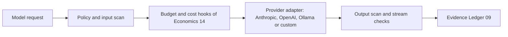

**What ships in 2.9:** `GovernedModelGateway` in TypeScript with adapters for Anthropic, OpenAI, Ollama and any endpoint with the OpenAI interface. The gateway evaluates the policy before the call, scans the output, writes to the Evidence Ledger (09) and can abort a stream on a violation. The hooks of Economics (14) add the budget check, the concurrency limit and the provider fallback.

**Where it lives:** [`AEP-Components/model-gateway/`](AEP-Components/model-gateway/), plus `AEP-Components/streaming/`.

**Run and test:** Run `npx vitest run AEP-Components/model-gateway AEP-Components/streaming` from the repository root. The component README has the detail: [`AEP-Components/model-gateway/README.md`](AEP-Components/model-gateway/README.md).

## 18 / TLA+

**What it is:** TLA+ is a language for formal models of a system. AEP writes the central kernel rules as TLA+ models, so a model checker can search every state of a rule for a violation.

**What ships in 2.9:** Five models: AdmitConjunction, DockPulse, WrapComplete, TemporalBounds and LastApplied. The checker `aep-tla-verify` tests the shape of every model in each run. It runs the TLC model checker only when the profile `AEP_TLA_PROFILE` is `warn` or `strict` and TLC is installed. The public Docker image installs neither TLC nor Apalache. The page states proven safety, liveness and freedom from deadlock. This tree ships the models and the checker. It ships no stored result of an exhaustive model check and such a proof run is planned. The conformance battery and the handshake verification belong to this component.

**Where it lives:** [`AEP-Components/tla/`](AEP-Components/tla/), plus `AEP-Components/verification/` and `AEP-Components/conformance/`.

**Run and test:** `cargo test -p aep-tla-verify` and `./AEP-Components/conformance/runner/run.sh`. The component README has the detail: [`AEP-Components/tla/README.md`](AEP-Components/tla/README.md).

## Shared parts

Four folders under `AEP-Components/` serve more than one component:

| Folder | Role |
|--------|------|
| [`AEP-Components/datasets/`](AEP-Components/datasets/) | A file based store of evaluation datasets with simple versions |
| [`AEP-Components/ede/`](AEP-Components/ede/) | Enforced draft environments, in which a coding agent changes a repository only through a scanned draft |
| [`AEP-Components/platform-core/`](AEP-Components/platform-core/) | Shared path helpers and the catalog of regulation modules |
| [`AEP-Components/ucm/`](AEP-Components/ucm/) | The Universal Computation Module, the exact calculation engine with signed receipts |

## Repository layout

| Directory | Role |
|-----------|------|
| [`AEP-Base-Node/`](AEP-Base-Node/) | Kernel: daemon, registry, Potomitan mesh, Agent Control Hub and the docks with UCB |
| [`AEP-Components/`](AEP-Components/) | Protocol components and the component map |
| [`AEP-CAW/`](AEP-CAW/) | CAW host sandboxes |
| [`AEP-Policy-System/`](AEP-Policy-System/) | GAP policies, presets, Policy Builder and Schema Builder |
| [`AEP-User-Experience/`](AEP-User-Experience/) | Harness, operator documents and examples |
| [`AEP-Research-Paper/`](https://github.com/thePM001/AEP-agent-element-protocol/blob/main/AEP-Research-Paper/) | DAL-AEP research paper assets (PDF + OTS proof) |
| [`docker/`](docker/) | Container entrypoint and runtime dependencies |
| [`rust/`](rust/) | Build output folder of the Rust workspace |

The root keeps the workspace files: `Cargo.toml`, `package.json`, `Dockerfile`, `docker-compose.yml`, `docker-compose.public.yml`, `docker-compose.test-fresh.yml`, `.env.example`, `aep-check.mjs`, `vitest.config.mjs`, `tsconfig.json`, `LICENSE`, `CHANGELOG.md`, `BIOSECURITY.md` and `THREAT_MODEL.md`. [`THREAT_MODEL.md`](THREAT_MODEL.md) is the engineering threat model of every layer and each mitigation in it cites the test or conformance check behind it. [`CHANGELOG.md`](CHANGELOG.md) lists the release history.

### Key services and ports

| Service | Default port | Notes |
|---------|--------------|-------|
| UCB | `8412` | **Optional.** Foreign attach only. Disable with `UCB=0`. See the [UCB README](AEP-Base-Node/AEP-Docks/ucb/README.md) |
| WASM sandbox | `wasm_sandbox` socket | Set `WASM_SANDBOX=1` in Docker |
| Base Node sockets | `/data/aep/sockets` | Inference, validation, future, regulation docks |

## Conformance and official run sequence

Public repository is https://github.com/thePM001/AEP-agent-element-protocol. GitHub is a public mirror. GitHub does not run CC-01 through CC-15.

Factory checks on the official tree:

```bash
cargo test -p aep-base-node --lib
./AEP-Components/conformance/runner/run.sh
docker compose up -d --build
```

Docker is the packaged run path. The conformance runner is the public-tier battery and public tier vendors run it before claiming AEP compliance.

Manifest: `AEP-Components/conformance/tests/manifest.json`. Every listed check runs on every run and the runner fails when one does not. Checks in the planned list make no compliance claim. The Rust kernel is normative and the language neutral vectors in `AEP-Components/conformance/vectors/v1` let an implementation in any language check itself without a Rust toolchain.

## Documentation index

| Doc | Topic |
|-----|-------|
| [`AEP-Base-Node/README.md`](AEP-Base-Node/README.md) | 01 AEP Base Node: kernel, docks, outbound request and operator guide |
| [`AEP-Base-Node/AEP-Docks/ucb/README.md`](AEP-Base-Node/AEP-Docks/ucb/README.md) | 02 UCB: foreign attach, task manifest and HTTP interface |
| [`AEP-Components/envelope/README.md`](AEP-Components/envelope/README.md) | 03 One Validation Envelope: the 15 walls and the derived record |
| [`AEP-Components/admit/README.md`](AEP-Components/admit/README.md) | 04 Admit Gate: collect-all judgement and wall families |
| [`AEP-Components/graph-engine/README.md`](AEP-Components/graph-engine/README.md) | 05 Graph Engine: workflow runner and checkpoints |
| [`AEP-Components/gap/README.md`](AEP-Components/gap/README.md) | 06 GAP: language, compile pipeline and CAW profile authoring |
| [`AEP-Components/dynAEP/README.md`](AEP-Components/dynAEP/README.md) | 07 dynAEP: event governance protocol |
| [`AEP-Components/lattice-channels/README.md`](AEP-Components/lattice-channels/README.md) | 08 Lattice Channels: sealed transport and its security rules |
| [`AEP-Components/evidence-ledger/README.md`](AEP-Components/evidence-ledger/README.md) | 09 Evidence Ledger: hash chain, Merkle proofs and rollback |
| [`AEP-Components/base-node-pulse/README.md`](AEP-Components/base-node-pulse/README.md) | 10 Base Node Pulse: compiled clocks of the kernel |
| [`AEP-CAW/README.md`](AEP-CAW/README.md) | 11 CAWs: `aep-caw`, shell adapter, policy engine and host integration |
| [`AEP-Components/scanners/README.md`](AEP-Components/scanners/README.md) | 12 Scanners: the scanner pipeline and the rule table |
| [`AEP-Components/agentmesh/README.md`](AEP-Components/agentmesh/README.md) | 13 AgentMesh: local identity issuance |
| [`AEP-Components/economics/README.md`](AEP-Components/economics/README.md) | 14 Economics: cost, budgets and x402 |
| [`AEP-Components/lattice-memory/README.md`](AEP-Components/lattice-memory/README.md) | 15 Lattice Memory: attractor store |
| [`AEP-Components/intent-ledger/README.md`](AEP-Components/intent-ledger/README.md) | 16 Intent Ledger: provenance of code changes |
| [`AEP-Components/model-gateway/README.md`](AEP-Components/model-gateway/README.md) | 17 Model Gateway: governed model calls |
| [`AEP-Components/tla/README.md`](AEP-Components/tla/README.md) | 18 TLA+: models and checker |

Operator guides:

| Doc | Topic |
|-----|-------|
| [`AEP-User-Experience/docs/AEP-2.9-SECURE-DEPLOYMENT-GUIDE.md`](AEP-User-Experience/docs/AEP-2.9-SECURE-DEPLOYMENT-GUIDE.md) | Secure deployment guide |
| [`AEP-Components/README.md`](AEP-Components/README.md) | Component map, status lines and TypeScript checks |
| [`AEP-Components/hyperlattice/CUSTOM-SUBLATTICE.md`](AEP-Components/hyperlattice/CUSTOM-SUBLATTICE.md) | How to attach a custom sub-lattice |
| [`AEP-Components/dynAEP/CONFIG.md`](AEP-Components/dynAEP/CONFIG.md) | dynAEP configuration reference |
| [`AEP-Base-Node/AEP-Agent-Control-Hub/README.md`](AEP-Base-Node/AEP-Agent-Control-Hub/README.md) | GAP capability profiles and CAW sandbox routing on Base Node |
| [`AEP-Base-Node/AEP-Docks/README.md`](AEP-Base-Node/AEP-Docks/README.md) | Socket docks, UCB and UCD |
| [`AEP-Policy-System/README.md`](AEP-Policy-System/README.md) | Policy files, presets and builders |
| [`AEP-Policy-System/SETUP.md`](AEP-Policy-System/SETUP.md) | Live Admit GAP node setup |
| [`AEP-Policy-System/schema-builder/README.md`](AEP-Policy-System/schema-builder/README.md) | Schema Builder |
| [`AEP-Policy-System/policy-builder/README.md`](AEP-Policy-System/policy-builder/README.md) | Policy Builder |
| [`AEP-User-Experience/README.md`](AEP-User-Experience/README.md) | Harness and operator documents |
| [`THREAT_MODEL.md`](THREAT_MODEL.md) | Threat model per layer with traced mitigations |
| [`AEP-Research-Paper/README.md`](https://github.com/thePM001/AEP-agent-element-protocol/blob/main/AEP-Research-Paper/README.md) | DAL-AEP paper + OTS proof |
| [`rust/README.md`](rust/README.md) | Rust workspace build |

---

## Research and licence


Research paper: [`AEP-Research-Paper/`](https://github.com/thePM001/AEP-agent-element-protocol/blob/main/AEP-Research-Paper/) - [GitHub mirror](https://github.com/thePM001/AEP-research-paper-001)

Licensed under Apache License 2.0. See [`LICENSE`](LICENSE).

---

## AI-Eligibility Status


To win the fight against the synthetic nano-parasites (SNP/NanoSinp) alien WMD, we must be intelligent and biosecure. It is recommended that bioinsecure humans do not use the provided technology/protocol to avoid bad techno-spiritual AI outcomes for them. [*"bioinsecure" = has installed injectable synthetic nano-parasites growth medium controllers - SNP GMCs]

See also: [`BIOSECURITY.md`](BIOSECURITY.md)
